**DENTAL CLINIC MANAGEMENT — FEATURE SRS**

**Software Requirements Specification**
**Advanced Feature Modules**

| Project Name | DCM — Dental Clinic Management |
| :---- | :---- |
| Version | 2.0 |
| Document Type | Software Requirements Specification (SRS) |
| Prepared By | Development Team |
| Date | March 9, 2026 |
| Scope | 3 New Feature Modules |

---

# **Table of Contents**

## **Part I: Introduction**

1\.   [Document Purpose & Scope]

2\.   [System Context & Current Architecture]

3\.   [Technology Stack Reference]

## **Part II: Feature 1 — AI-Assisted Dental Scan & Clinic Recommendation Chatbot**

4\.   [Feature Overview]

5\.   [Functional Requirements]

6\.   [Non-Functional Requirements]

7\.   [Database Schema Design]

8\.   [API Specification]

9\.   [High-Level Design]

10\.  [Low-Level Design]

11\.  [User Interface Specifications]

12\.  [Integration Points]

## **Part III: Feature 2 — Automated Prescription Follow-Up & Care Reminder System**

13\.  [Feature Overview]

14\.  [Functional Requirements]

15\.  [Non-Functional Requirements]

16\.  [Database Schema Design]

17\.  [API Specification]

18\.  [High-Level Design]

19\.  [Low-Level Design]

20\.  [User Interface Specifications]

21\.  [Integration Points]

## **Part IV: Feature 3 — Clinical Inventory & Procedure Readiness Management System**

22\.  [Feature Overview]

23\.  [Functional Requirements]

24\.  [Non-Functional Requirements]

25\.  [Database Schema Design]

26\.  [API Specification]

27\.  [High-Level Design]

28\.  [Low-Level Design]

29\.  [User Interface Specifications]

30\.  [Integration Points]

## **Part V: Cross-Feature Architecture**

31\.  [System Architecture Upgrade]

32\.  [Combined Database Schema Relationships]

33\.  [Job Queue Infrastructure]

34\.  [Security & Authorization]

35\.  [Deployment & Migration Strategy]

## **Part VI: Appendices**

36\.  [Glossary]

37\.  [File Manifest]

38\.  [Risk Assessment]

---


---

# **Part I: Introduction**

---

## **1. Document Purpose & Scope**

### **1.1 Purpose**

This Software Requirements Specification (SRS) document defines the complete technical and functional requirements for three new feature modules to be added to the Dental Clinic Management (DCM) platform. Each feature is designed to solve a specific operational gap in dental clinic workflows:

| Feature | Problem Solved |
| :---- | :---- |
| AI Dental Scan & Recommendation | Patients have no way to self-assess dental conditions or discover relevant specialists before visiting a clinic |
| Prescription Follow-Up & Care Reminders | Post-treatment care instructions are forgotten by patients, leading to poor recovery outcomes and low compliance |
| Clinical Inventory & Procedure Readiness | Doctors cannot verify equipment availability before scheduling complex procedures, causing delays and cancellations |

### **1.2 Scope**

This document covers:

 • Complete functional and non-functional requirements for each feature
 • Database schema designs with field-level specifications
 • REST API endpoint definitions with request/response contracts
 • High-Level Design (HLD) with architecture and sequence diagrams
 • Low-Level Design (LLD) with component diagrams, state machines, and ER diagrams
 • User interface specifications for Mobile App (React Native), Web Admin Panel (React), and Patient Portal
 • Integration points with existing DCM modules
 • Security, authorization, and multi-tenancy considerations
 • Deployment and migration strategies

### **1.3 Intended Audience**

 • Development Team — for implementation guidance
 • Project Manager — for scope and timeline estimation
 • QA Team — for test case derivation
 • Product Owner — for feature validation and acceptance criteria
 • DevOps — for infrastructure planning

### **1.4 Document Conventions**

 • **[MUST]** — Mandatory requirement, feature is incomplete without it
 • **[SHOULD]** — Important requirement, may be deferred to a patch release
 • **[MAY]** — Optional enhancement, can be added in a future iteration
 • All API paths are relative to `/api/v1`
 • All diagrams use Mermaid syntax for reproducibility

### **1.5 References**

 • DCM Technical Project Report v1.0 (Dental Clinic Management.md)
 • DCM Appointment Reminder & Patient Confirmation System (implemented)
 • Node.js API codebase (src/)
 • React Native mobile app (BestoClinicMobile/)
 • React web admin panel (website/)

---

## **2. System Context & Current Architecture**

### **2.1 Architecture Overview**

The DCM platform is a multi-tenant SaaS application built on a service-oriented monolith architecture:

```
┌─────────────────────────────────────────────────────────────────┐
│                        CLIENT LAYER                             │
│  ┌──────────────┐  ┌──────────────┐  ┌──────────────────────┐  │
│  │ Mobile App   │  │ Web Admin    │  │ Patient PWA          │  │
│  │ React Native │  │ React+Vite   │  │ QR-Based Web App     │  │
│  │ 0.75.4       │  │ 19.2.0       │  │                      │  │
│  └──────┬───────┘  └──────┬───────┘  └──────────┬───────────┘  │
│         │                 │                      │              │
│         └─────────────────┼──────────────────────┘              │
│                           │                                     │
│                    HTTPS / WSS                                  │
└───────────────────────────┼─────────────────────────────────────┘
                            │
┌───────────────────────────┼─────────────────────────────────────┐
│                     API GATEWAY LAYER                           │
│  ┌────────────────────────┴─────────────────────────────────┐  │
│  │              Express.js 4.21.0 (Node.js >= 18)           │  │
│  │  ┌─────────┐ ┌─────────┐ ┌──────────┐ ┌──────────────┐  │  │
│  │  │ Helmet  │ │  CORS   │ │ Rate     │ │ Correlation  │  │  │
│  │  │         │ │         │ │ Limiter  │ │ ID           │  │  │
│  │  └─────────┘ └─────────┘ └──────────┘ └──────────────┘  │  │
│  └──────────────────────────────────────────────────────────┘  │
│  ┌──────────────────────────────────────────────────────────┐  │
│  │              MIDDLEWARE PIPELINE                          │  │
│  │  JWT Auth → Tenant Resolver → Subscription Guard →       │  │
│  │  Feature Guard → Permission Authorize → Validate         │  │
│  └──────────────────────────────────────────────────────────┘  │
│  ┌──────────────────────────────────────────────────────────┐  │
│  │              Socket.IO 4.7.5 (Real-time)                 │  │
│  │  Chat Handler │ Notification Handler │ Video Handler     │  │
│  └──────────────────────────────────────────────────────────┘  │
└─────────────────────────────────────────────────────────────────┘
                            │
┌───────────────────────────┼─────────────────────────────────────┐
│                     BUSINESS LOGIC LAYER                        │
│  ┌────────────────────────────────────────────────────────┐    │
│  │  34 MODULES (routes → controller → service → model)    │    │
│  │  Auth │ Patient │ Appointment │ Prescription │ Invoice │    │
│  │  Portal │ Doctor │ Emergency │ Telemedicine │ Queue    │    │
│  │  Billing │ Payment │ Analytics │ Notification │ ...    │    │
│  └────────────────────────────────────────────────────────┘    │
│  ┌────────────────────────────────────────────────────────┐    │
│  │  SHARED SERVICES                                       │    │
│  │  Email │ Notification │ Storage │ Razorpay │ Reminder  │    │
│  └────────────────────────────────────────────────────────┘    │
└─────────────────────────────────────────────────────────────────┘
                            │
┌───────────────────────────┼─────────────────────────────────────┐
│                     JOB PROCESSING LAYER                        │
│  ┌──────────────────────────────────────────────────────────┐  │
│  │  BullMQ 5.12.12 (Redis-backed)                           │  │
│  │  9 Queues: email │ reminder │ reminderScan │ invoice │   │  │
│  │  report │ subscriptionLifecycle │ provisioning │ sync │   │  │
│  │  auditArchival                                           │  │
│  │  8 Workers: concurrent processing with retry strategies  │  │
│  └──────────────────────────────────────────────────────────┘  │
└─────────────────────────────────────────────────────────────────┘
                            │
┌───────────────────────────┼─────────────────────────────────────┐
│                     DATA LAYER                                  │
│  ┌──────────────┐  ┌──────────────┐  ┌──────────────────────┐  │
│  │ Platform DB  │  │ Tenant DBs   │  │ Redis                │  │
│  │ MongoDB Atlas│  │ Per-Clinic   │  │ ioredis 5.4.1        │  │
│  │              │  │ MongoDB      │  │                      │  │
│  │ Clinic       │  │ Patient      │  │ Session Cache        │  │
│  │ Plan         │  │ Appointment  │  │ Token Blacklist      │  │
│  │ Subscription │  │ Prescription │  │ Subscription Cache   │  │
│  │ PlatformUser │  │ Invoice      │  │ Queue Storage        │  │
│  │ Promotion    │  │ User         │  │ Tenant URI Cache     │  │
│  │ FeatureFlag  │  │ 30+ models   │  │                      │  │
│  └──────────────┘  └──────────────┘  └──────────────────────┘  │
│  ┌──────────────────────────────────────────────────────────┐  │
│  │  File Storage: Local (dev) / AWS S3 (prod)               │  │
│  └──────────────────────────────────────────────────────────┘  │
└─────────────────────────────────────────────────────────────────┘
```

### **2.2 Multi-Tenancy Model**

 • **Platform Database** — Shared MongoDB Atlas instance storing clinic metadata, subscription plans, feature flags, and platform-level audit logs
 • **Tenant Databases** — Isolated MongoDB instances per clinic, with encrypted connection URIs cached in Redis (1-hour TTL)
 • **Tenant Resolution** — `X-Tenant-ID` header validated against JWT `tenantSlug` claim via `tenantResolver()` middleware
 • **Data Isolation** — All queries scoped to tenant connection; cross-tenant access blocked at middleware level

### **2.3 Authentication & Authorization**

 • **JWT Authentication** — Three separate secrets: access (15min), refresh (7d), platform (product owner)
 • **Redis Token Blacklist** — Revoked tokens tracked via JTI in Redis
 • **Permission Matrix** — Role-based access control (RBAC) with granular permission keys (e.g., `PATIENT_READ_OWN`, `APPOINTMENT_CANCEL`)
 • **Feature Guards** — 3-tier hierarchy: tenant override > plan default > global feature flag

### **2.4 Existing Module Inventory (34 Modules)**

Auth, Patient, Appointment, Invoice, Clinic, User, Subscription, Dashboard, Branch, Department, Doctor, Staff, Insurance, Payroll, Notification, LegacyUpload, Integration, Role, Queue, Prescription, Consent, Emergency, DoctorDashboard, IntegrationViewer, PatientPortal, Telemedicine, Payment, Billing, CashRegister, CreditNote, Analytics, Public, Platform, Monitoring

### **2.5 Job Queue Infrastructure**

 • **Framework** — BullMQ 5.12.12 with Redis-backed persistence
 • **Existing Queues** — email, appointmentReminder, appointmentReminderScan, invoiceOverdue, reportGeneration, subscriptionLifecycle, provisioning, sync, auditArchival
 • **Workers** — 8 concurrent workers started at boot (lazy-loaded after Redis connection)
 • **Repeatable Jobs** — Subscription lifecycle (hourly), appointment reminder scan (every 15 minutes)

---

## **3. Technology Stack Reference**

### **3.1 Backend Technologies**

| Component | Technology | Version | Purpose |
| :---- | :---- | :---- | :---- |
| Runtime | Node.js | >= 18.0.0 | Server-side JavaScript execution |
| Framework | Express.js | 4.21.0 | HTTP request handling and routing |
| ODM | Mongoose | 8.23.0 | MongoDB schema management and queries |
| Cache | ioredis | 5.4.1 | Redis client for caching and sessions |
| Queue | BullMQ | 5.12.12 | Distributed job queue with Redis backend |
| Auth | jsonwebtoken | — | JWT token generation and validation |
| Validation | Joi | 17.13.3 | Request payload and environment validation |
| Email | Nodemailer | 8.0.1 | SMTP email delivery |
| Payments | Razorpay SDK | 2.9.4 | Payment gateway integration |
| Real-time | Socket.IO | 4.7.5 | WebSocket server for real-time events |
| Logging | Winston | 3.13.1 | Structured logging with daily rotation |
| Security | Helmet | 7.1.0 | HTTP security headers |
| Encryption | AES-256 | Built-in | Tenant database URI encryption |
| Hashing | bcryptjs | 2.4.3 | Password hashing |
| Rate Limiting | express-rate-limit | 7.4.0 | API rate limiting with Redis store |

### **3.2 Frontend Technologies**

| Component | Technology | Version | Purpose |
| :---- | :---- | :---- | :---- |
| Web Framework | React | 19.2.0 | Admin panel and patient portal UI |
| Build Tool | Vite | 7.3.1 | Fast development and production builds |
| Styling | Tailwind CSS | 4.2.1 | Utility-first CSS framework |
| Charts | Recharts | 3.7.0 | Dashboard data visualization |
| Icons | Lucide React | 0.575.0 | Icon library for web |
| Animation | Framer Motion | 12.34.3 | UI animations and transitions |
| Routing | React Router DOM | 7.13.1 | Client-side routing |

### **3.3 Mobile Technologies**

| Component | Technology | Version | Purpose |
| :---- | :---- | :---- | :---- |
| Framework | React Native | 0.75.4 | Cross-platform mobile app |
| State | Zustand | 4.5.5 | Lightweight state management |
| Server State | React Query | 5.59.0 | Server state synchronization and caching |
| Navigation | React Navigation | 6.x | Screen navigation (stack, tabs, drawer) |
| API Client | Axios | 1.6.0 | HTTP requests with interceptors |
| Storage | MMKV | 2.12.2 | Encrypted key-value local storage |
| Real-time | Socket.IO Client | 4.8.0 | WebSocket for notifications and chat |
| Video | react-native-webrtc | 124.0.4 | WebRTC for teleconsultation |
| Push | Firebase Messaging | 20.5.0 | Push notifications |
| Icons | Vector Icons | 10.2.0 | MaterialCommunityIcons |
| Camera | react-native-camera | — | Camera access for dental scan |
| Payments | React Native Razorpay | 2.3.0 | In-app payment flow |

### **3.4 New Technology Additions (For These Features)**

| Component | Technology | Purpose | Feature |
| :---- | :---- | :---- | :---- |
| AI Vision | Pluggable (see §3.6) | Dental image analysis | Feature 1 |
| Camera SDK | react-native-vision-camera | High-quality dental image capture | Feature 1 |
| AI Client | openai Node.js SDK / axios | Server-side AI API calls | Feature 1 |
| Cron Parsing | croner / cron-parser | Custom reminder schedule parsing | Feature 2 |

### **3.5A AI Vision Provider — Three Approaches**

The dental image analysis component is designed behind a **provider-agnostic interface** (`aiAnalysis.service.js`) so the underlying AI engine can be swapped without affecting any other part of the system (routes, queues, models, mobile app). Three approaches are supported:

#### **Approach A: Cloud AI API (Recommended for Phase 1)**

Use a hosted multimodal LLM to analyze dental images via HTTPS. No ML infrastructure needed.

| Provider | Model | Pros | Cons |
| :---- | :---- | :---- | :---- |
| OpenAI | GPT-4o / GPT-4 Vision | Best-in-class multimodal, structured JSON output, fast | Per-call cost (~$0.01-0.03/image), vendor lock-in, data leaves your server |
| Google Cloud | Gemini Pro Vision | Strong vision capabilities, competitive pricing | Different API shape, less dental-specific tuning |
| Azure | Azure OpenAI GPT-4V | Same model as OpenAI, data stays in Azure region | Requires Azure subscription, additional setup |

**Stack addition:** `openai` npm package (or `axios` for raw HTTP). Single env var (`OPENAI_API_KEY`).

**Architecture:**
```
Mobile App → Node.js API → BullMQ Queue → dentalScanAnalysisWorker
                                                ↓
                                          aiAnalysis.service.js
                                                ↓ (HTTPS)
                                          OpenAI / Gemini / Azure API
                                                ↓
                                          JSON observations → MongoDB
```

#### **Approach B: Self-Hosted ML Model (Full Control)**

Run your own fine-tuned dental vision model on a Python microservice. No data leaves your infrastructure.

| Component | Technology | Purpose |
| :---- | :---- | :---- |
| ML Framework | PyTorch or TensorFlow | Model training & inference |
| API Server | FastAPI | Python REST microservice |
| Image Processing | OpenCV, Pillow | Preprocessing dental images (resize, normalize, enhance) |
| Detection Model | YOLOv8 (ultralytics) | Object detection — cavity, plaque, inflammation regions |
| Classification | Fine-tuned EfficientNet / ResNet | Classify observation severity & type |
| Model Serving | TorchServe or TF Serving | Production model serving with batching & versioning |
| GPU Infra | NVIDIA T4 / A10G (AWS/GCP) | GPU inference (~100-200ms per image) |
| Communication | HTTP (internal network) | Node.js → Python bridge via private VPC |

**Architecture:**
```
Mobile App → Node.js API → BullMQ Queue → dentalScanAnalysisWorker
                                                ↓
                                          aiAnalysis.service.js
                                                ↓ (HTTP — internal network)
                                          Python FastAPI ML Service
                                                ↓
                                          PyTorch / TensorFlow
                                          Fine-tuned dental model (GPU)
                                                ↓
                                          JSON observations → MongoDB
```

**Requirements:**
 • **Training data**: ~5,000+ labeled dental images (cavities, plaque, gum disease, misalignment, etc.)
 • **Labeling**: Bounding box annotations for detection + classification labels
 • **Training time**: 2-4 weeks for initial model, ongoing retraining with new data
 • **GPU infrastructure**: Dedicated GPU instance for inference ($150-500/month depending on provider)
 • **ML expertise**: Data scientist / ML engineer for model development and maintenance

**Python microservice contract** (what `aiAnalysis.service.js` calls):
```
POST http://ml-service:8000/analyze
Content-Type: application/json

{
  "images": ["base64_image_1", "base64_image_2", ...],
  "options": { "minConfidence": 0.6 }
}

Response:
{
  "observations": [
    { "type": "cavity", "area": "Lower right molar", "toothNumbers": [30],
      "confidence": "high", "boundingBox": [x, y, w, h], "description": "..." }
  ],
  "overallSummary": "...",
  "recommendedSpecializations": ["endodontist", "periodontist"],
  "modelVersion": "dental-v1.2.0"
}
```

#### **Approach C: Hybrid (Recommended Overall Strategy)**

Ship fast with a cloud API, build a custom model in parallel, swap seamlessly.

| Phase | Timeline | Strategy | AI Backend |
| :---- | :---- | :---- | :---- |
| **Phase 1** | Months 1-3 | Ship MVP with cloud AI API | OpenAI GPT-4 Vision |
| **Phase 2** | Months 3-6 | Collect real dental images from usage, begin labeling & training | OpenAI (production) + PyTorch (training) |
| **Phase 3** | Months 6-9 | Shadow mode — run both, compare accuracy | Both in parallel |
| **Phase 4** | Month 9+ | Swap `aiAnalysis.service.js` to point at self-hosted model | Self-hosted PyTorch model |

**Why this works:** The entire system is designed so `aiAnalysis.service.js` is the **only file that knows which AI provider is being used**. Swapping the implementation inside that file changes nothing in:
 • Mongoose models (DentalScan, DentalScanResult)
 • BullMQ queue/worker (dentalScanAnalysisQueue/Worker)
 • API routes, controllers, validators
 • Mobile app screens
 • Doctor dashboard views

```
// aiAnalysis.service.js — provider switch
const PROVIDER = process.env.AI_VISION_PROVIDER || 'openai'; // 'openai' | 'self-hosted' | 'google'

async function analyzeDentalImages(images, options) {
  switch (PROVIDER) {
    case 'openai':     return _analyzeWithOpenAI(images, options);
    case 'google':     return _analyzeWithGemini(images, options);
    case 'self-hosted': return _analyzeWithLocalModel(images, options);
    default:           throw new Error(`Unknown AI provider: ${PROVIDER}`);
  }
}
```

### **3.5 Infrastructure**

| Component | Technology | Purpose |
| :---- | :---- | :---- |
| Database | MongoDB Atlas | Primary data storage (platform + tenants) |
| Cache/Queue | Redis (single instance) | Session cache, job queues, pub/sub |
| File Storage | Local (dev) / AWS S3 (prod) | Images, documents, X-rays, scan images |
| Process Manager | PM2 | Zero-downtime deployments |
| Monitoring | Winston + Custom health endpoints | Application monitoring |

---


---

# **Part II: Feature 1 — AI-Assisted Dental Scan & Clinic Recommendation Chatbot**

---

## **4. Feature Overview**

### **4.1 Problem Statement**

Currently, patients have no mechanism within the DCM platform to self-assess their dental condition before visiting a clinic. They must physically visit a dentist for even preliminary observations. This creates two problems:

 • **Patient hesitation** — Many patients delay dental visits due to uncertainty about the severity of their condition
 • **Missed conversions** — The platform has no digital funnel to convert curious users into booked appointments

### **4.2 Solution**

An AI-powered conversational dental scan feature that guides patients through capturing dental images using their mobile device camera. The system analyzes these images using computer vision AI to provide a high-level visual overview of the patient's dental condition, then recommends appropriate dentists from the clinic's registered network.

### **4.3 Business Objectives**

 • **Increase patient engagement** through an interactive self-check experience
 • **Drive appointment bookings** by connecting scan observations to relevant dentists
 • **Reduce consultation time** by providing doctors with preliminary visual data before the visit
 • **Create a conversion funnel**: curiosity → self-assessment → specialist discovery → appointment booking

### **4.4 Ethical & Legal Boundaries**

 • **[MUST]** All analysis outputs labeled as "observational" and "informational" — never as medical diagnosis
 • **[MUST]** Persistent disclaimer on every scan result: *"This is a preliminary visual assessment only. It is not a professional diagnosis. Please consult a licensed dentist for accurate evaluation and treatment."*
 • **[MUST]** System never recommends treatments, medications, or clinical procedures
 • **[MUST]** No clinical decisions made by AI — only visual pattern detection
 • **[MUST]** Scan data retained under clinic data retention policy with explicit patient consent
 • **[SHOULD]** AI model version tracked for auditability

### **4.5 User Roles**

| Role | Interaction |
| :---- | :---- |
| Patient | Initiates scan, captures images, views results, books appointments |
| Doctor | Views scan results during consultation (if patient shared), receives booking from scan |
| Admin | Views scan analytics (completion rates, conversion rates) |

---

## **5. Functional Requirements**

### **5.1 FR-DS-001: Scan Initiation**

 • **[MUST]** Patient can initiate a dental scan from the mobile app chatbot interface
 • **[MUST]** System displays a consent prompt before starting: *"Your dental images will be analyzed by AI for informational purposes only. Do you consent?"*
 • **[MUST]** Patient must accept consent to proceed
 • **[MUST]** System creates a `DentalScan` record with status `capturing`
 • **[SHOULD]** Show estimated scan duration (2-3 minutes)

### **5.2 FR-DS-002: Guided Image Capture**

 • **[MUST]** Chatbot guides patient through 5 sequential capture steps:

| Step | Angle | Instruction |
| :---- | :---- | :---- |
| 1 | Front view | "Close your teeth together, pull lips apart, and capture the front of your teeth" |
| 2 | Left side | "Turn your head slightly right and capture the left side of your teeth" |
| 3 | Right side | "Turn your head slightly left and capture the right side of your teeth" |
| 4 | Upper arch | "Open your mouth wide, tilt your phone down, and capture your upper teeth" |
| 5 | Lower arch | "Open your mouth wide, tilt your phone up, and capture your lower teeth" |

 • **[MUST]** Each step includes a visual overlay guide showing correct camera positioning
 • **[MUST]** Patient can retake any image before proceeding to next step
 • **[MUST]** Images uploaded to secure clinic-scoped file storage (local/S3)
 • **[SHOULD]** Image quality validation: minimum resolution 640x480, blur detection
 • **[MAY]** Auto-capture when alignment matches overlay template

### **5.3 FR-DS-003: AI Analysis**

 • **[MUST]** After all 5 images uploaded, patient triggers analysis
 • **[MUST]** System updates scan status to `processing` and enqueues analysis job
 • **[MUST]** BullMQ worker sends images to AI Vision API with structured analysis prompt
 • **[MUST]** AI identifies visual indicators from this set:

| Indicator | Description |
| :---- | :---- |
| Plaque buildup | Visible tartar or calculus deposits |
| Gum inflammation | Redness, swelling, or bleeding gums |
| Discoloration | Yellowing, staining, or dark spots on teeth |
| Misalignment | Crooked, crowded, or gapped teeth |
| Cavity indicators | Dark spots or visible decay |
| Gum recession | Exposed tooth roots or receding gumline |

 • **[MUST]** Each observation includes: type, affected area, confidence level (low/medium/high), description
 • **[MUST]** System generates an overall summary of observations
 • **[MUST]** Results stored in `DentalScanResult` linked to scan and patient
 • **[MUST]** Scan status updated to `completed` (or `failed` on error)
 • **[MUST]** Patient notified via WebSocket event `dental-scan:completed` and push notification
 • **[SHOULD]** Analysis latency tracked for performance monitoring
 • **[SHOULD]** AI model version recorded for auditability

### **5.4 FR-DS-004: Dentist Recommendation Engine**

 • **[MUST]** System maps observations to dental specializations:

| Observation | Mapped Specialization |
| :---- | :---- |
| Plaque buildup, Cavity | General Dentistry |
| Gum inflammation, Gum recession | Periodontics |
| Misalignment | Orthodontics |
| Discoloration | Cosmetic Dentistry |
| Cavity (severe) | Endodontics |

 • **[MUST]** Query registered doctors within the patient's clinic tenant by matched specializations
 • **[MUST]** Filter by: active status, branch availability, appointment availability
 • **[MUST]** Sort by: relevance to observations → average review rating → experience
 • **[MUST]** Return top 5 dentist recommendations with name, specialization, rating, availability
 • **[MUST]** Each recommendation includes a "Book Consultation" action that pre-fills the appointment booking form
 • **[SHOULD]** Show doctor's next available slot

### **5.5 FR-DS-005: Scan History**

 • **[MUST]** Patient can view all past scans with status and date
 • **[MUST]** Patient can view detailed results of any completed scan
 • **[SHOULD]** Doctor can view patient's scan history during consultation (if linked)
 • **[MAY]** Compare two scans side-by-side for progress tracking

### **5.6 FR-DS-006: Conversion Tracking**

 • **[SHOULD]** Track funnel metrics: scan initiated → images captured → analysis completed → recommendations viewed → appointment booked
 • **[SHOULD]** Analytics endpoint for admin: scan completion rate, recommendation click-through, booking conversion rate
 • **[MAY]** A/B test different recommendation presentation styles

---

## **6. Non-Functional Requirements**

### **6.1 Performance**

| Metric | Requirement |
| :---- | :---- |
| Image upload | < 3 seconds per image on 4G network |
| AI analysis | < 30 seconds end-to-end (including queue time) |
| Recommendation query | < 500ms response time |
| Concurrent scans | Support 50 simultaneous scans per tenant |

### **6.2 Scalability**

 • AI analysis jobs processed via BullMQ with configurable concurrency (default: 5 workers)
 • Image storage scales via S3 (production) with clinic-scoped prefixes
 • Scan results indexed for fast retrieval by patient and date

### **6.3 Reliability**

 • **[MUST]** If AI API fails, scan marked as `failed` with retry option for patient
 • **[MUST]** Images persisted before analysis — no data loss on worker crash
 • **[SHOULD]** Dead-letter queue for failed analysis jobs (manual retry by ops)

### **6.4 Security**

 • **[MUST]** Dental images encrypted at rest (S3 server-side encryption / local disk encryption)
 • **[MUST]** Images accessible only by the patient and their assigned doctor
 • **[MUST]** AI API calls use HTTPS with API key stored in environment variables (never committed)
 • **[MUST]** Consent logged with timestamp and IP address

### **6.5 Data Retention**

 • Scan images retained for 2 years (configurable per tenant)
 • Scan results retained indefinitely (or until patient requests deletion)
 • Expired scans purged via scheduled job

---

## **7. Database Schema Design**

### **7.1 DentalScan Model**

**Collection:** `dentalscans` (Tenant Database)

**Purpose:** Tracks a dental scan session from initiation through image capture to analysis completion.

```
DentalScan {
  _id:              ObjectId (auto-generated)
  patient:          ObjectId (ref: Patient, required, indexed)
  status:           String (enum: [capturing, processing, completed, failed],
                      default: 'capturing')
  images: [{
    angle:          String (enum: [front, left, right, upper, lower], required)
    fileUrl:        String (required, path to stored image)
    fileName:       String (original file name)
    fileSize:       Number (bytes)
    uploadedAt:     Date (default: Date.now)
  }]
  consentGiven:     Boolean (required, default: false)
  consentTimestamp: Date
  consentIp:        String (IPv4/IPv6 address)
  scanStartedAt:    Date (default: Date.now)
  completedAt:      Date
  failureReason:    String (populated on status: failed)
  analysisJobId:    String (BullMQ job ID for tracking)
  createdBy:        ObjectId (ref: User)
  deletedAt:        Date (soft-delete)
  createdAt:        Date (auto, via timestamps)
  updatedAt:        Date (auto, via timestamps)
}

Indexes:
  - { patient: 1, createdAt: -1 }       // Patient's scan history
  - { status: 1 }                        // Filter by processing status
  - { deletedAt: 1 }                     // Soft-delete filter

Pre-find Hook:
  - Automatically filters { deletedAt: null }
```

### **7.2 DentalScanResult Model**

**Collection:** `dentalscanresults` (Tenant Database)

**Purpose:** Stores the AI analysis output for a completed dental scan.

```
DentalScanResult {
  _id:                ObjectId (auto-generated)
  scan:               ObjectId (ref: DentalScan, required, unique, indexed)
  patient:            ObjectId (ref: Patient, required, indexed)
  observations: [{
    type:             String (enum: [plaque, inflammation, discoloration,
                        misalignment, cavity, gum_recession, other], required)
    area:             String (description of affected area)
    toothNumbers:     [Number] (1-32, universal numbering system)
    confidence:       String (enum: [low, medium, high], required)
    description:      String (human-readable observation text, required)
  }]
  overallSummary:     String (required, AI-generated summary paragraph)
  recommendedSpecs:   [String] (e.g., ['orthodontics', 'periodontics'])
  disclaimer:         String (default: standard disclaimer text)
  disclaimerAcknowledged: Boolean (default: false)
  analysisModel:      String (AI model version, e.g., 'gpt-4-vision-preview')
  analysisLatencyMs:  Number (total processing time in milliseconds)
  rawAiResponse:      Mixed (full AI response for debugging, select: false)
  createdAt:          Date (auto, via timestamps)
}

Indexes:
  - { scan: 1 }                          // One-to-one lookup
  - { patient: 1, createdAt: -1 }        // Patient history
  - { 'observations.type': 1 }           // Analytics: most common issues
```

---

## **8. API Specification**

### **8.1 Route Registration**

**Prefix:** `/portal/dental-scan`
**Authentication:** `authenticate()` → `tenantResolver()` → `requireRole('patient', 'guardian')`

### **8.2 Endpoints**

#### **POST /portal/dental-scan** — Initiate Scan

```
Purpose:  Create a new dental scan session
Auth:     Patient/Guardian role
Body:     { consentGiven: true }

Request:
  POST /api/v1/portal/dental-scan
  Headers: Authorization: Bearer <token>, X-Tenant-ID: <slug>
  Body: {
    "consentGiven": true
  }

Response (201 Created):
  {
    "success": true,
    "message": "Dental scan initiated",
    "data": {
      "_id": "65a...",
      "status": "capturing",
      "images": [],
      "consentGiven": true,
      "consentTimestamp": "2026-03-09T10:00:00.000Z",
      "scanStartedAt": "2026-03-09T10:00:00.000Z"
    }
  }

Validation (Joi):
  consentGiven: Joi.boolean().valid(true).required()

Errors:
  400 — Consent not given
  401 — Unauthorized
  403 — Not a patient/guardian
```

#### **PUT /portal/dental-scan/:id/upload** — Upload Scan Image

```
Purpose:  Upload a dental image for a specific angle
Auth:     Patient/Guardian role (must own the scan)
Params:   id — DentalScan ObjectId
Body:     { angle: 'front', image: '<base64 encoded image>' }

Request:
  PUT /api/v1/portal/dental-scan/65a.../upload
  Body: {
    "angle": "front",
    "image": "data:image/jpeg;base64,/9j/4AAQ..."
  }

Response (200 OK):
  {
    "success": true,
    "message": "Image uploaded",
    "data": {
      "angle": "front",
      "fileUrl": "/uploads/dental-scans/abc123.jpg",
      "uploadedAt": "2026-03-09T10:01:00.000Z",
      "imagesCount": 1,
      "remainingAngles": ["left", "right", "upper", "lower"]
    }
  }

Validation (Joi):
  angle: Joi.string().valid('front','left','right','upper','lower').required()
  image: Joi.string().required() // base64 or multipart

Errors:
  400 — Invalid angle or missing image
  403 — Not the scan owner
  404 — Scan not found
  409 — Angle already uploaded (must delete first)
```

#### **POST /portal/dental-scan/:id/analyze** — Trigger AI Analysis

```
Purpose:  Submit all images for AI analysis
Auth:     Patient/Guardian role (must own the scan)
Params:   id — DentalScan ObjectId

Request:
  POST /api/v1/portal/dental-scan/65a.../analyze

Response (202 Accepted):
  {
    "success": true,
    "message": "Analysis started. You will be notified when complete.",
    "data": {
      "status": "processing",
      "estimatedTime": "15-30 seconds"
    }
  }

Errors:
  400 — Not all 5 images captured
  403 — Not the scan owner
  404 — Scan not found
  409 — Scan already analyzed or currently processing
```

#### **GET /portal/dental-scan/:id/result** — Get Scan Result

```
Purpose:  Retrieve AI analysis results
Auth:     Patient/Guardian role (must own the scan)
Params:   id — DentalScan ObjectId

Response (200 OK):
  {
    "success": true,
    "message": "Scan result retrieved",
    "data": {
      "scan": "65a...",
      "observations": [
        {
          "type": "plaque",
          "area": "Lower front teeth (lingual surface)",
          "toothNumbers": [23, 24, 25, 26],
          "confidence": "high",
          "description": "Visible tartar buildup along the gumline..."
        },
        {
          "type": "inflammation",
          "area": "Upper gums (right side)",
          "toothNumbers": [3, 4, 5],
          "confidence": "medium",
          "description": "Mild redness and swelling detected..."
        }
      ],
      "overallSummary": "The scan detected 2 areas of concern...",
      "recommendedSpecs": ["general_dentistry", "periodontics"],
      "disclaimer": "This is a preliminary visual assessment only..."
    }
  }

Errors:
  403 — Not the scan owner
  404 — Scan not found or result not yet available
```

#### **GET /portal/dental-scan/:id/recommendations** — Get Doctor Recommendations

```
Purpose:  Get matched dentists based on scan observations
Auth:     Patient/Guardian role
Params:   id — DentalScan ObjectId

Response (200 OK):
  {
    "success": true,
    "message": "Recommendations retrieved",
    "data": {
      "recommendations": [
        {
          "doctor": {
            "_id": "doc1...",
            "name": "Dr. Priya Sharma",
            "specialization": "Periodontics",
            "consultationFee": 500,
            "averageRating": 4.8,
            "reviewCount": 42
          },
          "matchedObservations": ["inflammation", "gum_recession"],
          "relevanceScore": 0.95,
          "nextAvailableSlot": "2026-03-10T10:00:00.000Z"
        }
      ],
      "totalMatched": 3
    }
  }
```

#### **GET /portal/dental-scan/history** — List Patient Scans

```
Purpose:  List all scans for the authenticated patient
Auth:     Patient/Guardian role
Query:    patientId, page, limit

Response (200 OK):
  {
    "success": true,
    "message": "Scans retrieved",
    "data": [...],
    "pagination": { "total": 5, "page": 1, "limit": 10 }
  }
```

---

## **9. High-Level Design**

### **9.1 System Architecture Diagram**

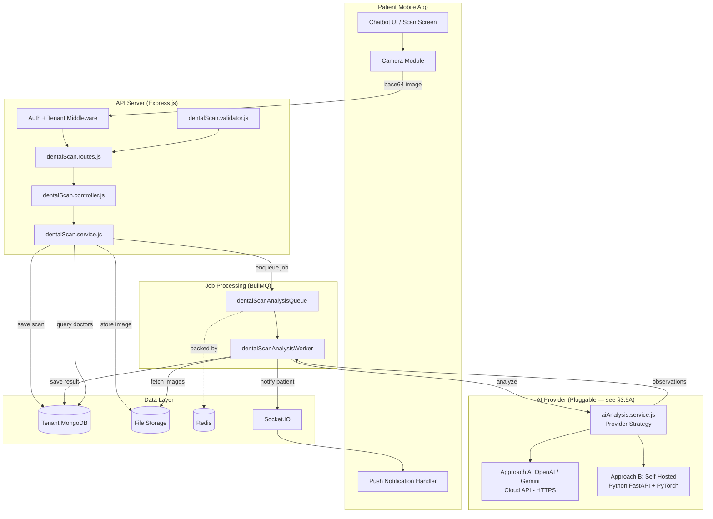

### **9.2 Sequence Diagram — Complete Scan Flow**

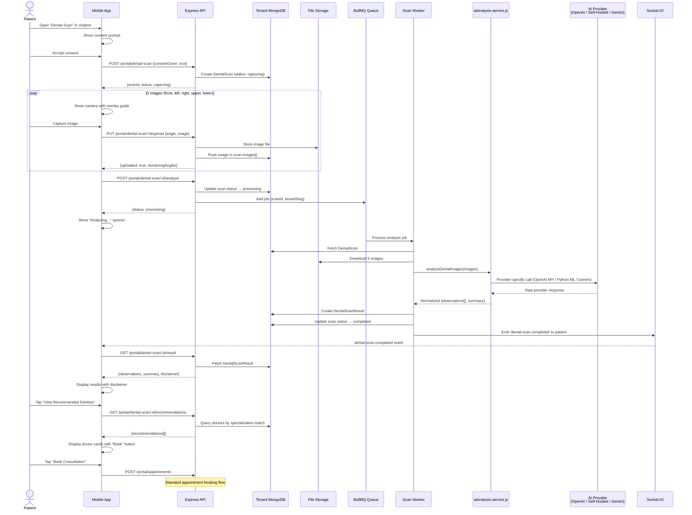

---

## **10. Low-Level Design**

### **10.1 Component Architecture**

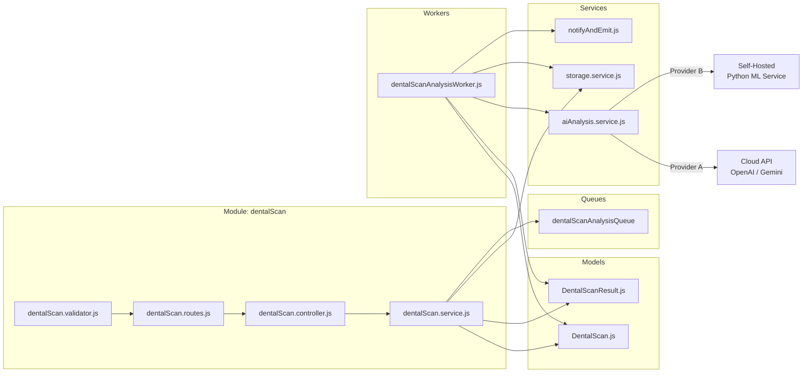

### **10.2 AI Analysis Service — Internal Design (Provider-Agnostic)**

The AI analysis service implements a **strategy pattern** — a common interface with swappable provider implementations. All three approaches return the same output schema, making them interchangeable.

#### **10.2.1 Common Interface & Output Contract**

```
aiAnalysis.service.js — Public API

  analyzeDentalImages(images: Buffer[], options?)
    1. Select provider based on AI_VISION_PROVIDER env var
    2. Delegate to provider-specific implementation
    3. Validate response against common schema (regardless of provider)
    4. Return: { observations[], overallSummary, recommendedSpecs[] }

  Common Output Schema (all providers MUST return this):
    {
      observations: [
        {
          type: 'cavity' | 'plaque' | 'inflammation' | 'discoloration' |
                'misalignment' | 'gum_recession' | 'other',
          area: string,             // e.g., "Lower right molar"
          toothNumbers: number[],   // Universal numbering (1-32)
          confidence: 'low' | 'medium' | 'high',
          description: string       // Patient-friendly
        }
      ],
      overallSummary: string,
      recommendedSpecializations: string[],  // e.g., ['endodontist', 'periodontist']
      disclaimer: "This is a preliminary visual assessment only..."
    }

  Provider Selection:
    const PROVIDER = process.env.AI_VISION_PROVIDER || 'openai';
    switch (PROVIDER) {
      case 'openai':      return _analyzeWithOpenAI(images, options);
      case 'google':      return _analyzeWithGemini(images, options);
      case 'self-hosted': return _analyzeWithLocalModel(images, options);
    }
```

#### **10.2.2 Provider A: OpenAI GPT-4 Vision (Cloud API)**

```
_analyzeWithOpenAI(images, options)

  1. Construct multi-image prompt with dental analysis instructions
  2. Call OpenAI GPT-4 Vision API:
     - model: process.env.OPENAI_MODEL || 'gpt-4o'
     - messages: [{ role: 'system', content: DENTAL_ANALYSIS_SYSTEM_PROMPT },
                  { role: 'user', content: [image1, image2, ...image5, textPrompt] }]
     - response_format: { type: 'json_object' }
     - max_tokens: 2000
  3. Parse JSON response into structured observations
  4. Validate against common schema
  5. Return normalized result

  Dependencies: openai npm package (or axios)
  Env vars: OPENAI_API_KEY, OPENAI_MODEL
  Cost: ~$0.01-0.03 per analysis (5 images)
  Latency: 3-8 seconds

  DENTAL_ANALYSIS_SYSTEM_PROMPT:
    "You are a dental visual analysis assistant. Analyze the provided dental
     images and identify ONLY visual observations. You must NEVER provide
     medical diagnoses, treatment plans, or prescriptions. Your output is
     purely observational and informational.

     For each observation, provide:
     - type: one of [plaque, inflammation, discoloration, misalignment,
       cavity, gum_recession, other]
     - area: description of affected area
     - toothNumbers: array of affected tooth numbers (1-32, universal system)
     - confidence: low, medium, or high
     - description: clear, patient-friendly description

     Always include this disclaimer in your summary:
     'This is a preliminary visual assessment only and not a professional
      diagnosis. Please consult a licensed dentist for accurate evaluation.'

     Return JSON format:
     {
       observations: [...],
       overallSummary: '...',
       recommendedSpecializations: [...]
     }"
```

#### **10.2.3 Provider B: Self-Hosted ML Model (Python Microservice)**

```
_analyzeWithLocalModel(images, options)

  1. Convert images to base64 strings
  2. POST to self-hosted Python FastAPI service:
     - URL: process.env.ML_SERVICE_URL || 'http://ml-service:8000/analyze'
     - Body: { images: [base64_1, base64_2, ...], options: { minConfidence: 0.6 } }
     - Timeout: 30 seconds
  3. Receive detection + classification results
  4. Map model output to common schema (model may return bounding boxes, etc.)
  5. Return normalized result

  Dependencies: axios (HTTP call to internal service)
  Env vars: ML_SERVICE_URL, ML_SERVICE_API_KEY (internal auth)
  Cost: GPU infrastructure (~$150-500/month fixed)
  Latency: 1-3 seconds (GPU), 5-15 seconds (CPU)

  Python Service Stack:
    - FastAPI (REST API)
    - PyTorch / TensorFlow (ML framework)
    - YOLOv8 / ultralytics (object detection)
    - EfficientNet / ResNet (classification)
    - OpenCV, Pillow (image preprocessing)
    - TorchServe or TF Serving (production serving)

  Python Service Contract:
    POST /analyze
    Request:  { images: string[], options?: { minConfidence: number } }
    Response: { observations: [...], overallSummary: string,
                recommendedSpecializations: string[], modelVersion: string }

  Training Requirements:
    - 5,000+ labeled dental images (bounding boxes + classification labels)
    - Labels: cavity, plaque, inflammation, discoloration, misalignment, gum_recession
    - Training: 2-4 weeks, ongoing retraining with new data
    - Validation: 80/10/10 train/val/test split, minimum 85% mAP for detection
```

#### **10.2.4 Provider C: Google Gemini Vision (Alternative Cloud API)**

```
_analyzeWithGemini(images, options)

  1. Construct multi-image prompt (same dental analysis instructions)
  2. Call Google Gemini Pro Vision API:
     - model: 'gemini-pro-vision'
     - contents: [{ parts: [image1, image2, ..., { text: prompt }] }]
     - generationConfig: { responseMimeType: 'application/json' }
  3. Parse JSON response
  4. Map to common schema (field names may differ)
  5. Return normalized result

  Dependencies: @google-cloud/vertexai or axios
  Env vars: GOOGLE_AI_API_KEY, GOOGLE_AI_MODEL
  Cost: ~$0.005-0.02 per analysis
  Latency: 3-10 seconds
```

#### **10.2.5 Error Handling (All Providers)**

```
Error Handling:
  - API/service timeout (30s) → throw ApiError.serviceUnavailable('AI analysis timed out')
  - Invalid response format → throw ApiError.internal('AI response parsing failed')
  - Rate limit exceeded → retry with exponential backoff (max 3 attempts)
  - API key invalid / service down → log critical error, throw ApiError.internal
  - Self-hosted model: health check endpoint at GET /health — monitored by PM2/Docker
  - All errors surfaced to patient as: "Analysis could not be completed. Please try again."
```

### **10.3 Recommendation Engine — Scoring Algorithm**

```
Input: DentalScanResult.recommendedSpecs[], DentalScanResult.observations[]

Step 1: Query doctors
  db.users.find({
    role: 'doctor',
    specialization: { $in: recommendedSpecs },
    isActive: true,
    deletedAt: null
  })

Step 2: Calculate relevance score per doctor
  For each doctor:
    matchedObservations = observations.filter(obs =>
      specToObservationMap[doctor.specialization].includes(obs.type)
    )
    relevanceScore = matchedObservations.length / observations.length

    // Boost by confidence
    confidenceBoost = sum(matchedObs.map(o =>
      o.confidence === 'high' ? 0.3 :
      o.confidence === 'medium' ? 0.2 : 0.1
    )) / matchedObservations.length

    finalScore = relevanceScore * 0.5 + confidenceBoost * 0.3 + (rating/5) * 0.2

Step 3: Sort by finalScore DESC, limit 5

Step 4: For each doctor, find next available appointment slot
  Appointment.find({
    doctor: doctor._id,
    scheduledAt: { $gte: now },
    status: { $nin: ['cancelled', 'no_show'] }
  }).sort({ scheduledAt: 1 }).limit(1)
```

### **10.4 Scan Status State Machine**

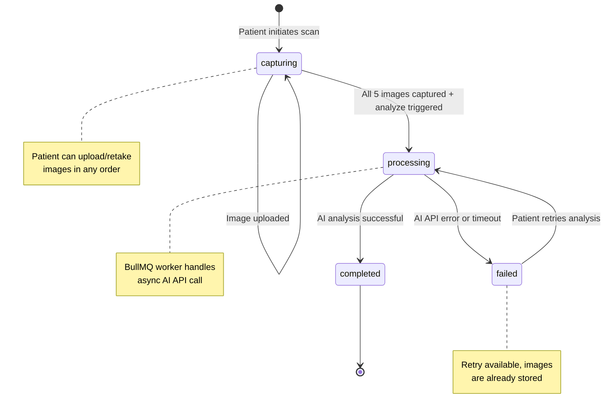

---

## **11. User Interface Specifications**

### **11.1 Mobile App — Dental Scan Chatbot Screen**

**Screen:** `DentalScanScreen.tsx`
**Navigation:** Accessible from Patient Dashboard → "Dental Scan" card or Chatbot tab

**UI Flow:**

```
┌─────────────────────────────┐
│  ← Dental Scan              │
│                              │
│  ┌────────────────────────┐  │
│  │  🦷 AI Dental Scan     │  │
│  │                        │  │
│  │  Get a quick visual    │  │
│  │  overview of your      │  │
│  │  dental health using   │  │
│  │  your phone camera.    │  │
│  │                        │  │
│  │  ⚠️ This is not a     │  │
│  │  medical diagnosis.    │  │
│  │                        │  │
│  │  ☐ I consent to AI     │  │
│  │    image analysis      │  │
│  │                        │  │
│  │  [Start Scan]          │  │
│  └────────────────────────┘  │
└─────────────────────────────┘

After consent → Camera capture flow:

┌─────────────────────────────┐
│  ← Step 1 of 5              │
│                              │
│  ┌────────────────────────┐  │
│  │                        │  │
│  │    Camera Preview      │  │
│  │    with overlay guide  │  │
│  │    (teeth outline)     │  │
│  │                        │  │
│  └────────────────────────┘  │
│                              │
│  📸 Front View               │
│  Close teeth, pull lips      │
│  apart                       │
│                              │
│  ● ○ ○ ○ ○  Progress dots   │
│                              │
│  [Capture]    [Skip]         │
└─────────────────────────────┘

After analysis → Results screen:

┌─────────────────────────────┐
│  ← Scan Results             │
│                              │
│  ┌────────────────────────┐  │
│  │ ✅ Analysis Complete   │  │
│  │ 2 observations found   │  │
│  └────────────────────────┘  │
│                              │
│  ┌────────────────────────┐  │
│  │ ⚠️ Plaque Buildup     │  │
│  │ Confidence: High       │  │
│  │ Lower front teeth      │  │
│  │ Visible tartar along...│  │
│  └────────────────────────┘  │
│                              │
│  ┌────────────────────────┐  │
│  │ ⚠️ Gum Inflammation   │  │
│  │ Confidence: Medium     │  │
│  │ Upper right gums       │  │
│  │ Mild redness detected..│  │
│  └────────────────────────┘  │
│                              │
│  ⚠️ Disclaimer: This is a  │
│  preliminary assessment...   │
│                              │
│  [View Recommended Dentists] │
└─────────────────────────────┘
```

### **11.2 Mobile App — Recommendation Cards**

```
┌─────────────────────────────┐
│  ← Recommended Dentists     │
│                              │
│  Based on your scan results: │
│                              │
│  ┌────────────────────────┐  │
│  │ 👤 Dr. Priya Sharma   │  │
│  │ Periodontics           │  │
│  │ ⭐ 4.8 (42 reviews)   │  │
│  │ Matches: inflammation, │  │
│  │ gum recession          │  │
│  │ Next slot: Mar 10, 10AM│  │
│  │ [Book Consultation]    │  │
│  └────────────────────────┘  │
│                              │
│  ┌────────────────────────┐  │
│  │ 👤 Dr. Rajesh Patel   │  │
│  │ General Dentistry      │  │
│  │ ⭐ 4.6 (38 reviews)   │  │
│  │ Matches: plaque        │  │
│  │ Next slot: Mar 10, 2PM │  │
│  │ [Book Consultation]    │  │
│  └────────────────────────┘  │
└─────────────────────────────┘
```

---

## **12. Integration Points**

### **12.1 Integration with Existing Modules**

| Existing Module | Integration | Direction |
| :---- | :---- | :---- |
| Patient Portal | Scan routes registered under `/portal/dental-scan` | Extends |
| Appointment Module | Recommendation "Book" action creates appointment | Calls into |
| Notification Module | Scan completion notification via `notifyAndEmit()` | Calls into |
| Storage Service | Image upload/download via `storage.service.js` | Calls into |
| User Model | Doctor query for recommendations by specialization | Reads from |
| Review Model | Doctor rating aggregation for recommendation sorting | Reads from |

### **12.2 External Integration**

| Service | Purpose | Protocol | Required For |
| :---- | :---- | :---- | :---- |
| OpenAI GPT-4 Vision | Dental image analysis (Approach A) | HTTPS REST API | Phase 1 |
| Google Gemini Vision | Dental image analysis (Alternative cloud) | HTTPS REST API | Optional |
| Self-Hosted ML Service | Dental image analysis (Approach B) | HTTP (internal) | Phase 2+ |
| Firebase FCM | Push notification on scan completion | HTTPS | All phases |
| AWS S3 | Production image storage | AWS SDK | All phases |

### **12.3 New Environment Variables**

```
# ─── AI Vision Provider Selection ───────────────────
AI_VISION_PROVIDER=openai          # 'openai' | 'google' | 'self-hosted'

# ─── Approach A: OpenAI (Phase 1) ──────────────────
OPENAI_API_KEY=sk-...              # OpenAI API key
OPENAI_MODEL=gpt-4o               # AI model to use (gpt-4o, gpt-4-vision-preview)

# ─── Approach A (alt): Google Gemini ────────────────
GOOGLE_AI_API_KEY=...              # Google AI API key (if using Gemini)
GOOGLE_AI_MODEL=gemini-pro-vision  # Gemini model

# ─── Approach B: Self-Hosted ML ─────────────────────
ML_SERVICE_URL=http://ml-service:8000  # Internal Python FastAPI service URL
ML_SERVICE_API_KEY=...                  # Internal service auth key

# ─── Common (all approaches) ───────────────────────
DENTAL_SCAN_MAX_IMAGES=5           # Number of required angles
DENTAL_SCAN_ANALYSIS_TIMEOUT=30000 # 30 second timeout
```

---


---

# **Part III: Feature 2 — Automated Prescription Follow-Up & Care Reminder System**

---

## **13. Feature Overview**

### **13.1 Problem Statement**

When a doctor creates a prescription or treatment plan, the care instructions are delivered to the patient as a static document. There is no active system to remind patients to follow through on prescribed tasks like taking medication, performing salt-water gargles, or following hygiene routines. This leads to:

 • **Poor treatment compliance** — Patients forget medications, skip care routines
 • **Slower recovery** — Inconsistent follow-through on post-treatment care
 • **Increased follow-up burden** — Doctors spend time manually checking if patients followed instructions
 • **Missed engagement** — No ongoing touchpoint between clinic visits

### **13.2 Solution**

An automated system that extracts actionable tasks from prescriptions and converts them into scheduled reminders delivered via push notifications, SMS, or automated calls. Patients opt-in when receiving a prescription, and doctors can view compliance dashboards during follow-up visits.

### **13.3 Business Objectives**

 • **Improve patient compliance** with post-treatment care instructions
 • **Reduce no-show follow-up visits** by maintaining patient engagement
 • **Reduce manual follow-up calls** by clinic staff
 • **Provide doctors with data-driven compliance insights** for better care decisions
 • **Strengthen patient-clinic relationship** through proactive care

### **13.4 User Roles**

| Role | Interaction |
| :---- | :---- |
| Doctor | Creates prescription (existing flow), views patient compliance dashboard |
| Patient | Opts-in to reminders, receives care reminders, marks tasks done/skipped |
| Admin | Configures reminder delivery channels, views aggregate compliance analytics |

---

## **14. Functional Requirements**

### **14.1 FR-CR-001: Prescription Task Extraction**

 • **[MUST]** When a prescription is created, system parses `medications[]` array to extract individual care tasks
 • **[MUST]** Each medication mapped to a `PrescriptionTask` with: title, instructions, frequency, start date, end date
 • **[MUST]** Support these task types:

| Task Type | Example | Source Field |
| :---- | :---- | :---- |
| medication | "Take Amoxicillin 500mg" | medications[].name + dosage |
| hygiene | "Brush with soft toothbrush" | medications[].instructions |
| post_care | "Salt-water gargle after meals" | medications[].instructions |
| follow_up | "Follow-up visit in 7 days" | prescription.followUpDate |
| dietary | "Avoid hard foods for 3 days" | medications[].instructions |

 • **[MUST]** Frequency mapping:

| Prescription Frequency | Reminders/Day | Default Times |
| :---- | :---- | :---- |
| Once daily | 1 | 09:00 |
| Twice daily | 2 | 09:00, 21:00 |
| Thrice daily / Three times | 3 | 08:00, 14:00, 20:00 |
| Four times daily | 4 | 08:00, 12:00, 16:00, 20:00 |
| After meals | 3 | 09:30, 14:30, 20:30 |
| Before meals | 3 | 08:30, 13:30, 19:30 |
| At bedtime | 1 | 21:30 |

 • **[SHOULD]** Allow patient to customize reminder times after opt-in
 • **[MAY]** AI-assisted task extraction for free-text instructions

### **14.2 FR-CR-002: Patient Opt-In Flow**

 • **[MUST]** When prescription is delivered (via app notification), show prompt: *"Would you like to enable care reminders for this prescription?"*
 • **[MUST]** Patient can select: **Enable** or **Skip**
 • **[MUST]** If enabled, extract tasks and schedule all reminders
 • **[MUST]** Store opt-in timestamp on prescription record
 • **[MUST]** Patient can disable reminders for a specific prescription at any time
 • **[MUST]** Patient can enable/disable all reminders globally from account settings
 • **[SHOULD]** Show preview of reminder schedule before enabling

### **14.3 FR-CR-003: Reminder Scheduling & Delivery**

 • **[MUST]** Each reminder scheduled as a delayed BullMQ job with calculated delay
 • **[MUST]** Primary delivery: in-app push notification via `notifyAndEmit()`
 • **[SHOULD]** Secondary delivery: SMS/WhatsApp (if enabled on plan)
 • **[MAY]** Tertiary delivery: automated voice call for critical medications
 • **[MUST]** Reminder content includes: task title, instructions, "Mark Done" / "Skip" quick actions
 • **[MUST]** Safety-net scanner job (every 30 minutes) catches missed reminders
 • **[MUST]** Reminder not sent if: task deactivated, patient disabled reminders, reminder already sent

### **14.4 FR-CR-004: Patient Response Tracking**

 • **[MUST]** Patient can mark each reminder as **Done** or **Skipped** from app
 • **[MUST]** Response updates `CareReminder.status` and increments task counters
 • **[MUST]** If no response within 4 hours after delivery, status auto-set to `missed`
 • **[SHOULD]** Streak tracking: consecutive completed reminders
 • **[MAY]** Gamification: badges for 7-day, 14-day, 30-day compliance streaks

### **14.5 FR-CR-005: Compliance Dashboard (Doctor)**

 • **[MUST]** Doctor can view patient compliance summary during consultation
 • **[MUST]** Dashboard shows per-prescription:
   - Total tasks and reminders
   - Completion rate (percentage)
   - Skipped and missed count
   - Active tasks vs completed tasks
 • **[SHOULD]** Visual timeline of daily compliance
 • **[SHOULD]** Highlight non-compliant areas for doctor review
 • **[MAY]** Aggregate compliance analytics across all patients for admin

### **14.6 FR-CR-006: Prescription Reminder Lifecycle**

 • **[MUST]** Reminders automatically stop when prescription `endDate` passes
 • **[MUST]** If prescription cancelled/voided, all pending reminders cancelled
 • **[MUST]** If patient disables reminders, all pending jobs removed from queue
 • **[SHOULD]** Re-enabling reminders reschedules only future reminders (not past ones)

---

## **15. Non-Functional Requirements**

### **15.1 Performance**

| Metric | Requirement |
| :---- | :---- |
| Task extraction | < 2 seconds for a prescription with 10 medications |
| Reminder scheduling | < 5 seconds to schedule all reminders for one prescription |
| Reminder delivery | Within 60 seconds of scheduled time |
| Compliance query | < 500ms response time |

### **15.2 Scalability**

 • Support 10,000 active reminders per tenant
 • BullMQ worker concurrency configurable (default: 10)
 • Reminder scanner processes all tenants within 5 minutes

### **15.3 Reliability**

 • **[MUST]** Failed reminder delivery retried 3 times with exponential backoff
 • **[MUST]** Prescription task data immutable after creation (audit trail)
 • **[MUST]** No duplicate reminders for the same task at the same time (BullMQ jobId deduplication)

---

## **16. Database Schema Design**

### **16.1 PrescriptionTask Model**

**Collection:** `prescriptiontasks` (Tenant Database)

**Purpose:** Represents an individual care task extracted from a prescription. Each medication or care instruction becomes one task.

```
PrescriptionTask {
  _id:              ObjectId (auto-generated)
  prescription:     ObjectId (ref: Prescription, required, indexed)
  patient:          ObjectId (ref: Patient, required, indexed)
  doctor:           ObjectId (ref: User, indexed)
  taskType:         String (enum: [medication, hygiene, post_care,
                      follow_up, dietary], required)
  title:            String (required, max: 200)
                    // e.g., "Take Amoxicillin 500mg"
  instructions:     String (max: 1000)
                    // e.g., "Take after food with warm water"
  frequency:        String (enum: [once, twice_daily, thrice_daily,
                      four_times_daily, after_meals, before_meals,
                      bedtime, custom], required)
  customTimes:      [String]
                    // e.g., ['08:00', '14:00', '20:00'] for custom
  startDate:        Date (required)
  endDate:          Date (required)
  totalReminders:   Number (calculated: remindersPerDay × durationDays)
  completedCount:   Number (default: 0)
  skippedCount:     Number (default: 0)
  missedCount:      Number (default: 0)
  isActive:         Boolean (default: true)
  deactivatedAt:    Date
  createdBy:        ObjectId (ref: User)
  deletedAt:        Date
  createdAt:        Date (auto)
  updatedAt:        Date (auto)
}

Indexes:
  - { prescription: 1 }                 // All tasks for a prescription
  - { patient: 1, isActive: 1 }         // Active tasks for patient
  - { patient: 1, createdAt: -1 }       // Patient task history
  - { deletedAt: 1 }

Virtuals:
  - completionRate = completedCount / totalReminders * 100
  - remainingReminders = totalReminders - completedCount - skippedCount - missedCount
```

### **16.2 CareReminder Model**

**Collection:** `carereminders` (Tenant Database)

**Purpose:** Represents a single scheduled reminder instance. Each PrescriptionTask generates many CareReminder entries (one per scheduled delivery).

```
CareReminder {
  _id:              ObjectId (auto-generated)
  task:             ObjectId (ref: PrescriptionTask, required, indexed)
  patient:          ObjectId (ref: Patient, required, indexed)
  prescription:     ObjectId (ref: Prescription, indexed)
  scheduledAt:      Date (required, indexed)
  status:           String (enum: [pending, sent, done, skipped, missed,
                      cancelled], default: 'pending')
  sentAt:           Date
  respondedAt:      Date
  response:         String (enum: [done, skipped], only set when patient responds)
  deliveryChannel:  String (enum: [push, sms, email, call])
  reminderJobId:    String (BullMQ job ID for cancellation)
  notificationId:   ObjectId (ref: Notification, for in-app link)
  deletedAt:        Date
  createdAt:        Date (auto)
}

Indexes:
  - { task: 1, scheduledAt: 1 }          // Task's reminder timeline
  - { patient: 1, status: 1, scheduledAt: 1 }  // Patient's pending reminders
  - { scheduledAt: 1, status: 1 }        // Scanner query: overdue pending
  - { reminderJobId: 1 }                 // Job lookup for cancellation
  - { deletedAt: 1 }
```

### **16.3 Prescription Model Extension**

**Added fields to existing `Prescription` schema:**

```
// Added to existing Prescription model:
followUpRemindersEnabled: {
  type: Boolean,
  default: false
}
reminderOptInAt: Date
tasksExtracted: {
  type: Boolean,
  default: false
}
```

---

## **17. API Specification**

### **17.1 Patient Portal Routes**

**Prefix:** `/portal` (existing patient portal)

#### **POST /portal/prescriptions/:id/enable-reminders** — Enable Care Reminders

```
Purpose:  Opt-in to receive care reminders for a prescription
Auth:     Patient/Guardian role
Params:   id — Prescription ObjectId

Request:
  POST /api/v1/portal/prescriptions/65b.../enable-reminders?patientId=PAT-123

Response (200 OK):
  {
    "success": true,
    "message": "Care reminders enabled",
    "data": {
      "prescription": "65b...",
      "tasksCreated": 3,
      "totalReminders": 45,
      "firstReminderAt": "2026-03-10T08:00:00.000Z",
      "lastReminderAt": "2026-03-17T20:00:00.000Z"
    }
  }

Errors:
  400 — Reminders already enabled
  403 — Not the prescription patient
  404 — Prescription not found
```

#### **DELETE /portal/prescriptions/:id/disable-reminders** — Disable Care Reminders

```
Purpose:  Opt-out and cancel all pending reminders
Auth:     Patient/Guardian role

Response (200 OK):
  {
    "success": true,
    "message": "Care reminders disabled",
    "data": {
      "cancelledReminders": 32,
      "cancelledJobs": 32
    }
  }
```

#### **GET /portal/care-tasks** — List Active Care Tasks

```
Purpose:  Get all active care tasks for the patient
Auth:     Patient/Guardian role
Query:    patientId, status (active/completed/all)

Response (200 OK):
  {
    "success": true,
    "message": "Care tasks retrieved",
    "data": [
      {
        "_id": "task1...",
        "title": "Take Amoxicillin 500mg",
        "taskType": "medication",
        "frequency": "thrice_daily",
        "startDate": "2026-03-09",
        "endDate": "2026-03-16",
        "totalReminders": 21,
        "completedCount": 5,
        "skippedCount": 1,
        "missedCount": 0,
        "completionRate": 23.8,
        "isActive": true,
        "nextReminder": "2026-03-10T14:00:00.000Z"
      }
    ]
  }
```

#### **PUT /portal/care-tasks/:taskId/reminders/:id** — Mark Reminder

```
Purpose:  Patient marks a reminder as done or skipped
Auth:     Patient/Guardian role
Body:     { response: 'done' | 'skipped' }

Response (200 OK):
  {
    "success": true,
    "message": "Reminder marked as done",
    "data": {
      "reminder": { ... },
      "task": {
        "completedCount": 6,
        "completionRate": 28.6
      }
    }
  }
```

### **17.2 Doctor Dashboard Routes**

**Prefix:** `/doctor`

#### **GET /doctor/patients/:patientId/compliance** — Patient Compliance

```
Purpose:  View care compliance for a specific patient
Auth:     Doctor role

Response (200 OK):
  {
    "success": true,
    "message": "Patient compliance retrieved",
    "data": {
      "patient": { "_id": "...", "name": "John" },
      "prescriptions": [
        {
          "_id": "rx1...",
          "diagnosis": "Tooth extraction aftercare",
          "createdAt": "2026-03-05",
          "tasks": [
            {
              "title": "Take Amoxicillin 500mg",
              "completionRate": 85.7,
              "completedCount": 18,
              "totalReminders": 21,
              "skippedCount": 2,
              "missedCount": 1
            }
          ],
          "overallComplianceRate": 82.3
        }
      ],
      "averageCompliance": 82.3
    }
  }
```

---

## **18. High-Level Design**

### **18.1 Sequence Diagram — Care Reminder Flow**

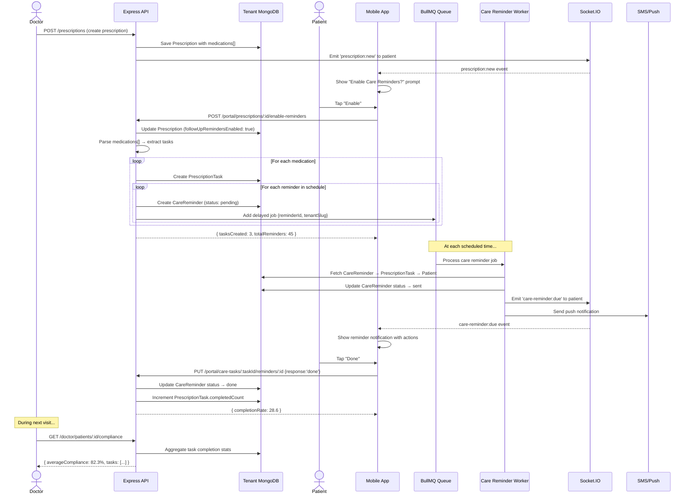

---

## **19. Low-Level Design**

### **19.1 Task Extractor Utility**

```
taskExtractor.js

Function: extractTasks(prescription, patient)
  Input:  Prescription document with medications[] array
  Output: Array of PrescriptionTask-ready objects

  Algorithm:
    tasks = []
    for each med in prescription.medications:
      task = {
        prescription: prescription._id,
        patient: patient._id,
        doctor: prescription.doctor,
        taskType: classifyTaskType(med),
        title: `${med.name} ${med.dosage || ''}`.trim(),
        instructions: med.instructions || '',
        frequency: mapFrequency(med.frequency),
        startDate: prescription.createdAt || new Date(),
        endDate: calculateEndDate(med.duration, startDate),
        totalReminders: calculateTotal(frequency, duration)
      }
      tasks.push(task)

    // Add follow-up task if followUpDate exists
    if (prescription.followUpDate):
      tasks.push({
        taskType: 'follow_up',
        title: 'Follow-up visit',
        frequency: 'once',
        startDate: dayBefore(prescription.followUpDate),
        endDate: prescription.followUpDate,
        totalReminders: 1
      })

    return tasks

  classifyTaskType(medication):
    keywords = {
      medication: ['tablet', 'capsule', 'syrup', 'drops', 'mg', 'ml'],
      hygiene: ['brush', 'floss', 'rinse', 'mouthwash'],
      post_care: ['gargle', 'ice', 'compress', 'rest'],
      dietary: ['avoid', 'diet', 'eat', 'food', 'drink']
    }
    // Match by keywords in name + instructions
    // Default: 'medication'

  mapFrequency(freqString):
    mapping = {
      'once daily': 'once',
      'twice daily': 'twice_daily',
      'three times': 'thrice_daily',
      'thrice daily': 'thrice_daily',
      'after meals': 'after_meals',
      'before meals': 'before_meals',
      'at bedtime': 'bedtime',
      'at night': 'bedtime'
    }
    return mapping[freqString.toLowerCase()] || 'once'
```

### **19.2 Reminder State Machine**

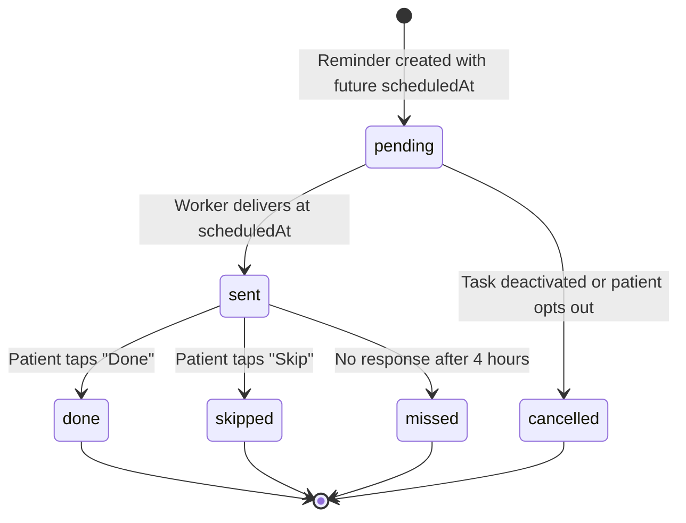

### **19.3 Component Architecture**

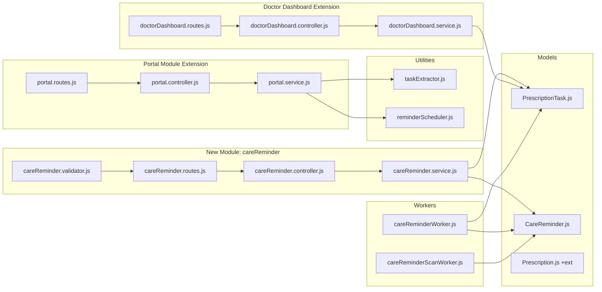

---

## **20. User Interface Specifications**

### **20.1 Mobile App — Reminder Opt-In Prompt**

Displayed as a bottom sheet or modal when patient views a new prescription:

```
┌─────────────────────────────┐
│                              │
│  📋 Care Reminders           │
│                              │
│  Your doctor prescribed      │
│  3 medications for 7 days.   │
│                              │
│  Would you like automated    │
│  reminders to help you       │
│  follow your care plan?      │
│                              │
│  • Amoxicillin 500mg (3x/day)│
│  • Ibuprofen 200mg (2x/day) │
│  • Salt-water gargle (3x/day)│
│                              │
│  Total: 56 reminders over    │
│  7 days                      │
│                              │
│  [Enable Reminders]          │
│  [Skip for now]              │
│                              │
└─────────────────────────────┘
```

### **20.2 Mobile App — Care Task Tracker**

New tab or section in Patient Portal:

```
┌─────────────────────────────┐
│  ← My Care Plan             │
│                              │
│  Overall: 78% compliant     │
│  ████████████░░░░  78%       │
│                              │
│  ┌────────────────────────┐  │
│  │ 💊 Amoxicillin 500mg  │  │
│  │ 3x daily • Day 4 of 7 │  │
│  │ ██████████░░░  72%     │  │
│  │ Next: Today 2:00 PM    │  │
│  └────────────────────────┘  │
│                              │
│  ┌────────────────────────┐  │
│  │ 🧂 Salt-water gargle  │  │
│  │ After meals • Day 4/7  │  │
│  │ █████████████░  85%    │  │
│  │ Next: Today 2:30 PM    │  │
│  └────────────────────────┘  │
│                              │
│  [Disable All Reminders]     │
└─────────────────────────────┘
```

### **20.3 Web Admin — Doctor Compliance View**

Column or expandable section in patient detail during consultation:

```
┌──────────────────────────────────────────────────────────┐
│  Patient Compliance — John Doe                            │
│                                                           │
│  Prescription: Tooth extraction aftercare (Mar 5, 2026)   │
│  Overall Compliance: 82.3%                                │
│                                                           │
│  Task                    Done  Skip  Miss  Rate           │
│  ─────────────────────────────────────────────────        │
│  Amoxicillin 500mg       18     2     1    85.7%          │
│  Ibuprofen 200mg         12     1     1    85.7%          │
│  Salt-water gargle       14     3     4    66.7%   ⚠️     │
│                                                           │
│  ⚠️ Patient skipping salt-water gargles frequently        │
└──────────────────────────────────────────────────────────┘
```

---

## **21. Integration Points**

| Existing Module | Integration | Direction |
| :---- | :---- | :---- |
| Prescription Module | Extends model with reminder fields; hooks into create flow | Extends |
| Patient Portal | New routes for opt-in/out and task management | Extends |
| Doctor Dashboard | New compliance endpoint | Extends |
| Notification Module | Reminder delivery via `notifyAndEmit()` | Calls into |
| Job Queue System | New `careReminderQueue` + `careReminderScanQueue` | Adds to |

---


---

# **Part IV: Feature 3 — Clinical Inventory & Procedure Readiness Management System**

---

## **22. Feature Overview**

### **22.1 Problem Statement**

When a doctor determines that a patient requires a complex procedure (dental implant, braces installation, surgical extraction), there is no way to verify whether the clinic has the required equipment and materials in stock. This leads to:

 • **Scheduling failures** — Procedures scheduled without confirming material availability
 • **Patient frustration** — Appointments cancelled or delayed due to missing equipment
 • **Operational waste** — Staff manually tracking inventory via spreadsheets or memory
 • **Revenue loss** — Complex high-value procedures delayed unnecessarily

### **22.2 Solution**

A centralized inventory management system integrated with appointment scheduling. Doctors can verify material availability during consultation, reserve materials for scheduled procedures, and receive automated notifications when restocked items satisfy pending procedure requirements.

### **22.3 Business Objectives**

 • **Zero procedure cancellations** due to material unavailability
 • **Automated stock monitoring** replacing manual spreadsheet tracking
 • **Doctor confidence** — real-time visibility into equipment readiness
 • **Operational efficiency** — automated alerts for low stock and expiring items
 • **Cost control** — usage analytics and wastage tracking

### **22.4 User Roles**

| Role | Interaction |
| :---- | :---- |
| Doctor | Checks material availability, reserves materials for procedures |
| Staff/Receptionist | Manages inventory (add, update, restock), handles low-stock alerts |
| Admin | Views inventory reports, configures thresholds, manages procedure templates |

---

## **23. Functional Requirements**

### **23.1 FR-INV-001: Inventory Item Management**

 • **[MUST]** Staff can create, update, and soft-delete inventory items
 • **[MUST]** Each item tracked with: name, code (unique), category, current stock, reserved stock, minimum threshold, cost, unit, supplier, branch, expiry date
 • **[MUST]** Items categorized by type:

| Category | Examples |
| :---- | :---- |
| braces | Metal brackets, ceramic brackets, self-ligating, lingual |
| implants | Titanium implants, abutments, healing caps |
| prosthetics | Crowns, bridges, dentures, veneers |
| surgical_kits | Extraction kits, bone grafting kits, suture kits |
| consumables | Anesthetics, bonding agents, impression materials |
| instruments | Scalers, elevators, forceps, handpieces |
| orthodontic | Arch wires, elastic bands, retainers |
| endodontic | Root canal files, gutta percha, sealers |
| periodontal | Curettes, probes, membranes |
| imaging | X-ray films, sensors, phosphor plates |
| sterilization | Autoclave pouches, indicators, solutions |

 • **[MUST]** Branch-level inventory isolation (each branch has own stock)
 • **[SHOULD]** Clinic-wide aggregate view for admin
 • **[MUST]** Virtual fields: `availableStock` = currentStock - reservedStock
 • **[MUST]** Virtual fields: `isLowStock` = availableStock <= minimumThreshold

### **23.2 FR-INV-002: Procedure Templates**

 • **[MUST]** Admin can create reusable procedure templates defining required materials
 • **[MUST]** Template includes: name, code, category, list of required materials (item + quantity), estimated duration
 • **[MUST]** Required materials can be marked as optional or mandatory
 • **[SHOULD]** Templates linked to departments

### **23.3 FR-INV-003: Availability Check**

 • **[MUST]** Doctor can check material availability for a procedure template
 • **[MUST]** System checks each required material against branch inventory
 • **[MUST]** Response indicates:
   - `ready: true` — all mandatory materials available, procedure can be scheduled
   - `ready: false` — missing items listed with required vs available quantities

### **23.4 FR-INV-004: Material Reservation**

 • **[MUST]** When scheduling a procedure with available materials, system reserves required quantities
 • **[MUST]** Reserved stock deducted from available (not current) stock
 • **[MUST]** Each reservation linked to: appointment, patient, procedure template, items with quantities
 • **[MUST]** `InventoryTransaction` (type: `reserved`) created for audit trail
 • **[MUST]** Reservation auto-released if appointment is cancelled:
   - Reserved quantities added back to available stock
   - `InventoryTransaction` (type: `released`) created
   - Reservation status updated to `released`
 • **[SHOULD]** When procedure completed, reservation status → `used` and `InventoryTransaction` (type: `stock_out`) created

### **23.5 FR-INV-005: Restocking & Alerts**

 • **[MUST]** Staff can restock items (increase currentStock)
 • **[MUST]** `InventoryTransaction` (type: `stock_in`) created on restock
 • **[MUST]** Low-stock alert triggered when `availableStock <= minimumThreshold`
 • **[MUST]** Expiry alert for items expiring within 30 days
 • **[MUST]** When restocked item satisfies a pending procedure's requirement, notify the doctor:
   *"Materials for [Patient]'s [Procedure] are now available. Ready to schedule."*
 • **[SHOULD]** Dashboard widget showing items below threshold

### **23.6 FR-INV-006: Inventory Reports**

 • **[SHOULD]** Usage trends: monthly/quarterly consumption per item
 • **[SHOULD]** Most consumed materials (ranked list)
 • **[SHOULD]** Wastage tracking (expired items)
 • **[SHOULD]** Cost analysis per procedure type
 • **[MAY]** Branch-wise inventory comparison

---

## **24. Non-Functional Requirements**

### **24.1 Performance**

| Metric | Requirement |
| :---- | :---- |
| Availability check | < 500ms for a procedure with 20 required items |
| Reservation creation | < 1 second (including transaction logging) |
| Low-stock query | < 300ms |
| Inventory list | < 500ms for 500 items with pagination |

### **24.2 Data Integrity**

 • **[MUST]** All stock changes recorded in `InventoryTransaction` (immutable audit trail)
 • **[MUST]** Concurrent reservations handled with MongoDB atomic operations (`$inc`)
 • **[MUST]** Race condition prevention: use `findOneAndUpdate` with `{ returnOriginal: false }` and post-check validation

### **24.3 Security**

 • **[MUST]** Only authorized roles can modify inventory (Staff, Admin)
 • **[MUST]** Doctors can only read inventory and create reservations
 • **[MUST]** Transaction log is append-only (no updates/deletes)

---

## **25. Database Schema Design**

### **25.1 InventoryItem Model**

**Collection:** `inventoryitems` (Tenant Database)

```
InventoryItem {
  _id:                ObjectId (auto-generated)
  name:               String (required, maxlength: 200, indexed)
  code:               String (unique, uppercase, required, maxlength: 30)
  category:           String (enum: [braces, implants, prosthetics,
                        surgical_kits, consumables, instruments, orthodontic,
                        endodontic, periodontal, imaging, sterilization, other],
                        required)
  description:        String (maxlength: 500)
  unit:               String (default: 'piece')
                      // e.g., piece, set, ml, pack, box
  currentStock:       Number (required, min: 0)
  reservedStock:      Number (default: 0, min: 0)
  minimumThreshold:   Number (default: 5, min: 0)
  costPerUnit:        Number (min: 0)
  currency:           String (default: 'INR')
  supplier: {
    name:             String (maxlength: 200)
    contactPhone:     String (maxlength: 20)
    contactEmail:     String (maxlength: 100)
    leadTimeDays:     Number (min: 0)
  }
  expiryDate:         Date (indexed, for consumables)
  branch:             ObjectId (ref: Branch, required, indexed)
  lastRestockedAt:    Date
  lastRestockedBy:    ObjectId (ref: User)
  isActive:           Boolean (default: true)
  createdBy:          ObjectId (ref: User)
  deletedAt:          Date
  createdAt:          Date (auto)
  updatedAt:          Date (auto)
}

Indexes:
  - { code: 1 }                        (unique)
  - { branch: 1, category: 1 }         (branch + category filter)
  - { branch: 1, isActive: 1 }         (active items per branch)
  - { expiryDate: 1 }                  (expiry alerts)
  - { deletedAt: 1 }
  - text: { name: 'text' }             (search)

Virtuals:
  - availableStock: this.currentStock - this.reservedStock
  - isLowStock: this.availableStock <= this.minimumThreshold
  - isExpiringSoon: this.expiryDate && this.expiryDate <= Date.now() + 30days
```

### **25.2 InventoryTransaction Model**

**Collection:** `inventorytransactions` (Tenant Database)

**Purpose:** Immutable audit log of all stock changes.

```
InventoryTransaction {
  _id:                ObjectId (auto-generated)
  item:               ObjectId (ref: InventoryItem, required, indexed)
  type:               String (enum: [stock_in, stock_out, reserved, released,
                        adjustment, expired, damaged], required)
  quantity:           Number (required)
                      // Positive for stock_in/released, negative for stock_out/reserved
  previousStock:      Number (required)
  newStock:           Number (required)
  previousReserved:   Number
  newReserved:        Number
  reason:             String (maxlength: 500)
  reference:          ObjectId
  referenceModel:     String (enum: [Appointment, MaterialReservation])
  branch:             ObjectId (ref: Branch, indexed)
  performedBy:        ObjectId (ref: User, required)
  createdAt:          Date (auto)
}

Indexes:
  - { item: 1, createdAt: -1 }         (item transaction history)
  - { type: 1, createdAt: -1 }         (filter by transaction type)
  - { branch: 1, createdAt: -1 }       (branch transaction log)

Immutability Guards:
  - Block all updateOne, updateMany, findOneAndUpdate operations
  - Block all deleteOne, deleteMany operations
  - Only allow insertOne / create (write-once)
```

### **25.3 ProcedureTemplate Model**

**Collection:** `proceduretemplates` (Tenant Database)

```
ProcedureTemplate {
  _id:                ObjectId (auto-generated)
  name:               String (required, maxlength: 200)
                      // e.g., "Dental Implant Placement"
  code:               String (unique, uppercase, maxlength: 30)
  category:           String (enum: [surgery, orthodontic, prosthetic,
                        endodontic, periodontal, cosmetic, diagnostic, other])
  description:        String (maxlength: 1000)
  requiredMaterials: [{
    item:             ObjectId (ref: InventoryItem, required)
    itemName:         String (denormalized for display)
    quantity:         Number (required, min: 1)
    isOptional:       Boolean (default: false)
  }]
  estimatedDuration:  Number (minutes, min: 10)
  estimatedCost:      Number (min: 0)
  department:         ObjectId (ref: Department)
  isActive:           Boolean (default: true)
  createdBy:          ObjectId (ref: User)
  deletedAt:          Date
  createdAt:          Date (auto)
  updatedAt:          Date (auto)
}

Indexes:
  - { code: 1 }                        (unique)
  - { category: 1, isActive: 1 }       (template search)
  - { deletedAt: 1 }
```

### **25.4 MaterialReservation Model**

**Collection:** `materialreservations` (Tenant Database)

```
MaterialReservation {
  _id:                ObjectId (auto-generated)
  appointment:        ObjectId (ref: Appointment, required, indexed)
  patient:            ObjectId (ref: Patient, required, indexed)
  procedure:          ObjectId (ref: ProcedureTemplate, required)
  items: [{
    item:             ObjectId (ref: InventoryItem, required)
    itemName:         String (denormalized)
    quantity:         Number (required, min: 1)
    status:           String (enum: [reserved, used, released],
                        default: 'reserved')
  }]
  status:             String (enum: [reserved, partially_used, used,
                        released, cancelled], default: 'reserved')
  reservedAt:         Date (default: Date.now)
  releasedAt:         Date
  usedAt:             Date
  reservedBy:         ObjectId (ref: User, required)
  branch:             ObjectId (ref: Branch, required, indexed)
  notes:              String (maxlength: 500)
  deletedAt:          Date
  createdAt:          Date (auto)
  updatedAt:          Date (auto)
}

Indexes:
  - { appointment: 1 }                 (one reservation per appointment)
  - { patient: 1, status: 1 }          (patient's active reservations)
  - { branch: 1, status: 1 }           (branch reservations)
  - { 'items.item': 1, status: 1 }     (find reservations for an item)
  - { deletedAt: 1 }
```

---

## **26. API Specification**

### **26.1 Inventory Management Routes**

**Prefix:** `/inventory`
**Auth:** `authenticate()` → `tenantResolver()`

```
GET    /inventory                    → listItems
       authorize(INVENTORY_READ)
       Query: branch, category, search, lowStock, expiring, page, limit

POST   /inventory                    → createItem
       authorize(INVENTORY_CREATE)
       Body: { name, code, category, unit, currentStock, minimumThreshold,
               costPerUnit, supplier, expiryDate, branch }

GET    /inventory/:id                → getItem
       authorize(INVENTORY_READ)

PUT    /inventory/:id                → updateItem
       authorize(INVENTORY_UPDATE)
       Body: { name, category, minimumThreshold, costPerUnit, supplier, ... }
       Note: Cannot directly modify currentStock/reservedStock (use restock)

DELETE /inventory/:id                → softDeleteItem
       authorize(INVENTORY_DELETE)

PUT    /inventory/:id/restock        → restockItem
       authorize(INVENTORY_UPDATE)
       Body: { quantity, reason, supplierNote }
       Side effects:
         - Creates InventoryTransaction (type: stock_in)
         - Checks pending reservations needing this item
         - Notifies relevant doctors if pending procedures now satisfiable

GET    /inventory/low-stock          → getLowStockAlerts
       authorize(INVENTORY_READ)
       Returns: items where availableStock <= minimumThreshold

GET    /inventory/expiring           → getExpiringItems
       authorize(INVENTORY_READ)
       Query: days (default: 30)
       Returns: items where expiryDate <= now + days

GET    /inventory/reports            → getInventoryReports
       authorize(INVENTORY_READ)
       Query: type (usage, cost, wastage), from, to, branch
```

### **26.2 Procedure Template Routes**

**Prefix:** `/procedures`
**Auth:** `authenticate()` → `tenantResolver()`

```
GET    /procedures                            → listTemplates
       authorize(PROCEDURE_READ)

POST   /procedures                            → createTemplate
       authorize(PROCEDURE_CREATE)
       Body: { name, code, category, requiredMaterials[], estimatedDuration }

PUT    /procedures/:id                        → updateTemplate
       authorize(PROCEDURE_UPDATE)

GET    /procedures/:id/check-availability     → checkMaterialAvailability
       authorize(PROCEDURE_READ)
       Query: branch (required)
       Returns: { ready: true/false, items: [{item, required, available, sufficient}],
                  missingItems: [{item, required, available, deficit}] }
```

### **26.3 Material Reservation Routes**

**Prefix:** `/reservations`
**Auth:** `authenticate()` → `tenantResolver()`

```
POST   /reservations                          → reserveMaterials
       authorize(RESERVATION_CREATE)
       Body: { appointmentId, procedureId, branch }
       Side effects:
         - Checks all materials available
         - Atomically increments reservedStock on each item
         - Creates InventoryTransaction (type: reserved) per item
         - Creates MaterialReservation

GET    /reservations/:appointmentId           → getReservation
       authorize(RESERVATION_READ)

DELETE /reservations/:id                      → releaseReservation
       authorize(RESERVATION_RELEASE)
       Side effects:
         - Atomically decrements reservedStock
         - Creates InventoryTransaction (type: released)
         - Updates reservation status → released
```

---

## **27. High-Level Design**

### **27.1 Sequence Diagram — Procedure Readiness Check & Reservation**

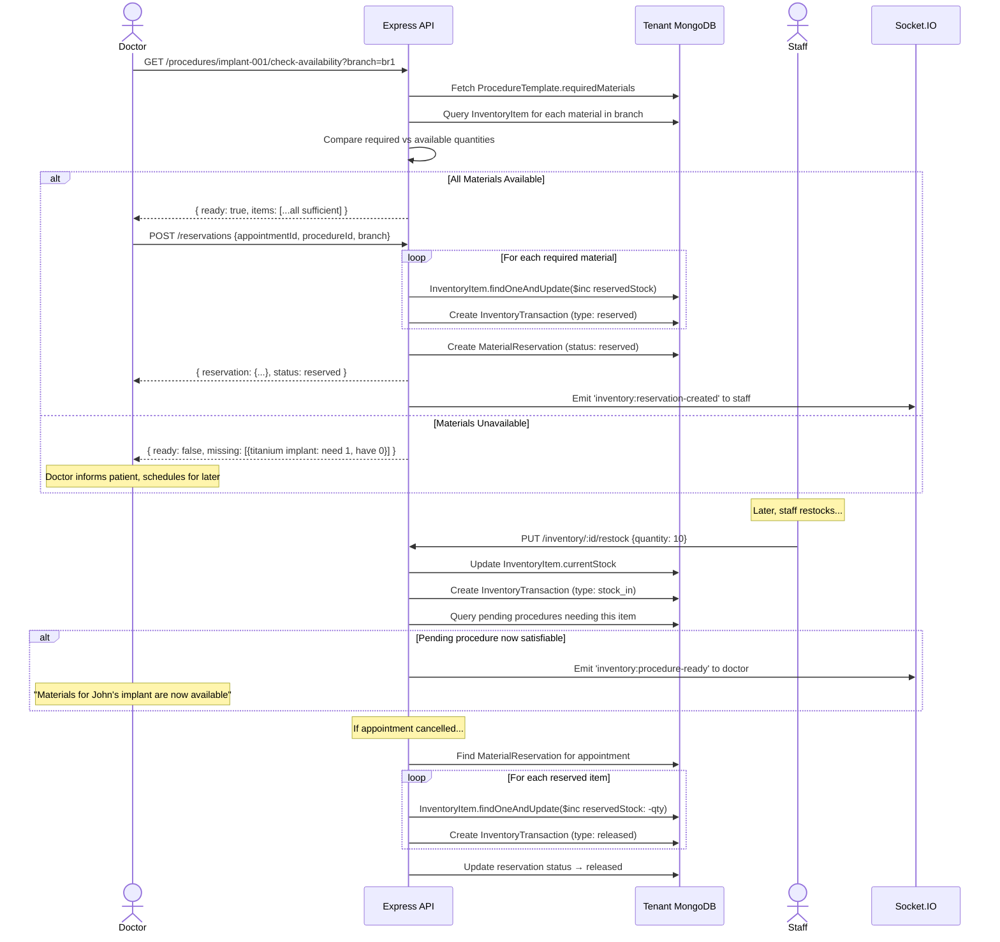

---

## **28. Low-Level Design**

### **28.1 Inventory Stock State Machine**

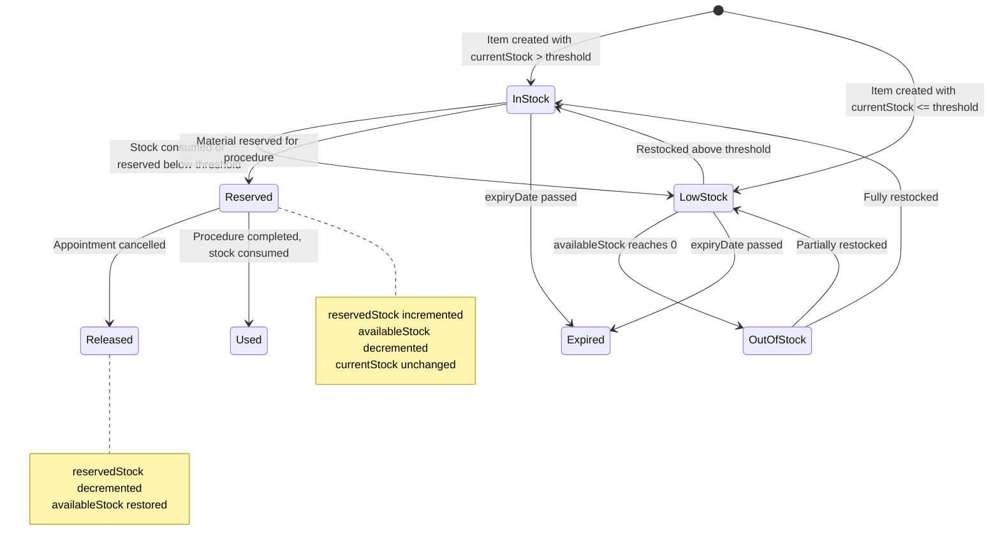

### **28.2 Atomic Stock Operations**

```
Reserve Materials (prevent race conditions):

  async function reserveItemStock(itemId, quantity, session) {
    const result = await InventoryItem.findOneAndUpdate(
      {
        _id: itemId,
        deletedAt: null,
        $expr: {
          $gte: [
            { $subtract: ['$currentStock', '$reservedStock'] },
            quantity
          ]
        }
      },
      {
        $inc: { reservedStock: quantity }
      },
      {
        new: true,
        session  // MongoDB transaction
      }
    );

    if (!result) {
      throw ApiError.conflict('Insufficient stock for reservation');
    }

    return result;
  }

Release Materials:

  async function releaseItemStock(itemId, quantity, session) {
    await InventoryItem.findOneAndUpdate(
      { _id: itemId },
      { $inc: { reservedStock: -quantity } },
      { session }
    );
  }

Note: Use MongoDB transactions (session) to ensure atomicity
across multiple items in a single reservation.
```

### **28.3 Component Architecture**

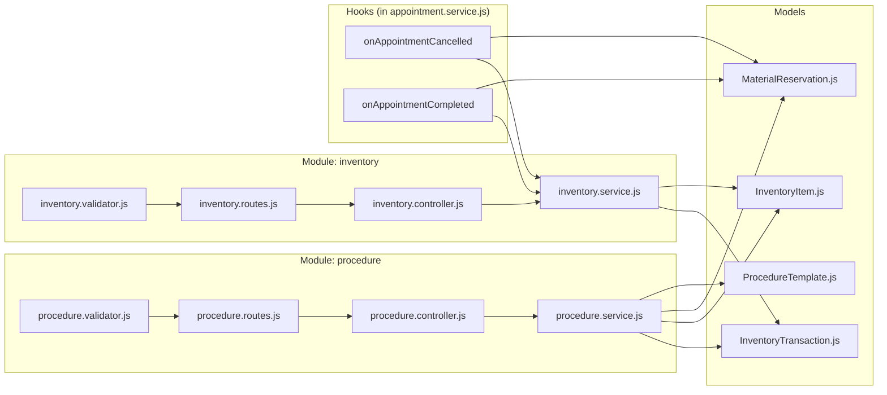

---

## **29. User Interface Specifications**

### **29.1 Web Admin — Inventory Dashboard**

```
┌──────────────────────────────────────────────────────────────┐
│  📦 Inventory Management                    [+ Add Item]     │
│                                                               │
│  ┌─────────┐ ┌─────────┐ ┌─────────┐ ┌───────────┐         │
│  │ Total   │ │Low Stock│ │Expiring │ │ Reserved  │         │
│  │  247    │ │   12 ⚠️ │ │   5 🔴  │ │    23     │         │
│  └─────────┘ └─────────┘ └─────────┘ └───────────┘         │
│                                                               │
│  Search: [____________] Category: [All ▾] Branch: [Main ▾]  │
│                                                               │
│  ┌────────────────────────────────────────────────────────┐  │
│  │ Code    │ Name              │ Stock │ Reserved │ Avail  │  │
│  │─────────┼───────────────────┼───────┼──────────┼────── │  │
│  │ IMP-001 │ Titanium Implant  │   15  │    3     │  12   │  │
│  │ BRC-002 │ Ceramic Brackets  │    8  │    2     │   6   │  │
│  │ ANE-003 │ Lidocaine 2%      │    3  │    0     │   3 ⚠️│  │
│  │ SUT-004 │ Vicryl Sutures    │   50  │    5     │  45   │  │
│  └────────────────────────────────────────────────────────┘  │
│                                                               │
│  ⚠️ = Below minimum threshold                                │
└──────────────────────────────────────────────────────────────┘
```

### **29.2 Web Admin — Procedure Availability Check**

```
┌──────────────────────────────────────────────────────────────┐
│  🔍 Check Procedure Readiness                                │
│                                                               │
│  Procedure: [Dental Implant Placement ▾]                     │
│  Branch:    [Main Branch ▾]                                  │
│                                                               │
│  [Check Availability]                                        │
│                                                               │
│  ┌────────────────────────────────────────────────────────┐  │
│  │ ✅ READY — All materials available                     │  │
│  │                                                        │  │
│  │ Material            │ Required │ Available │ Status    │  │
│  │─────────────────────┼──────────┼───────────┼───────── │  │
│  │ Titanium Implant    │    1     │    12     │ ✅       │  │
│  │ Healing Cap         │    1     │     8     │ ✅       │  │
│  │ Surgical Kit        │    1     │     3     │ ✅       │  │
│  │ Lidocaine 2%        │    2     │     3     │ ✅       │  │
│  │ Vicryl Sutures      │    1     │    45     │ ✅       │  │
│  │                                                        │  │
│  │ [Reserve Materials & Schedule]                         │  │
│  └────────────────────────────────────────────────────────┘  │
└──────────────────────────────────────────────────────────────┘
```

---

## **30. Integration Points**

| Existing Module | Integration | Direction |
| :---- | :---- | :---- |
| Appointment Module | Auto-release reservation on cancel; consume on complete | Hooks into |
| Branch Module | Inventory scoped to branches | Reads from |
| Department Module | Procedure templates linked to departments | Reads from |
| Notification Module | Low-stock, expiry, and procedure-ready alerts | Calls into |
| Permission System | New permission keys added to `permissions.js` | Extends |
| Route Registry | New `/inventory`, `/procedures`, `/reservations` prefixes | Extends |

---


---

# **Part V: Cross-Feature Architecture**

---

## **31. System Architecture Upgrade**

### **31.1 Updated System Component Diagram**

The three new features add 5 new modules, 8 new models, 3 new BullMQ queues, and 4 new workers to the existing architecture:

```
Before (Current):
  34 modules │ 30+ tenant models │ 9 queues │ 8 workers

After (With New Features):
  39 modules │ 38+ tenant models │ 12 queues │ 12 workers
  + 1 external AI service integration
```

### **31.2 New Queues & Workers**

| Queue | Worker | Frequency | Purpose |
| :---- | :---- | :---- | :---- |
| `dentalScanAnalysisQueue` | `dentalScanAnalysisWorker` | Event-driven | AI image analysis |
| `careReminderQueue` | `careReminderWorker` | Delayed jobs | Deliver care reminders |
| `careReminderScanQueue` | `careReminderScanWorker` | Every 30 min | Catch missed reminders |
| (existing `emailQueue`) | (existing `emailWorker`) | Event-driven | Email delivery for all features |

### **31.3 New Route Prefixes**

Added to `src/routes/index.js`:

```
router.use('/inventory',        inventoryRoutes);
router.use('/procedures',       procedureRoutes);
router.use('/reservations',     reservationRoutes);
// Portal dental scan routes registered under /portal/dental-scan
// Care reminder routes registered under /portal/care-tasks
// Doctor compliance routes registered under /doctor/patients/:id/compliance
```

---

## **32. Combined Database Schema Relationships**

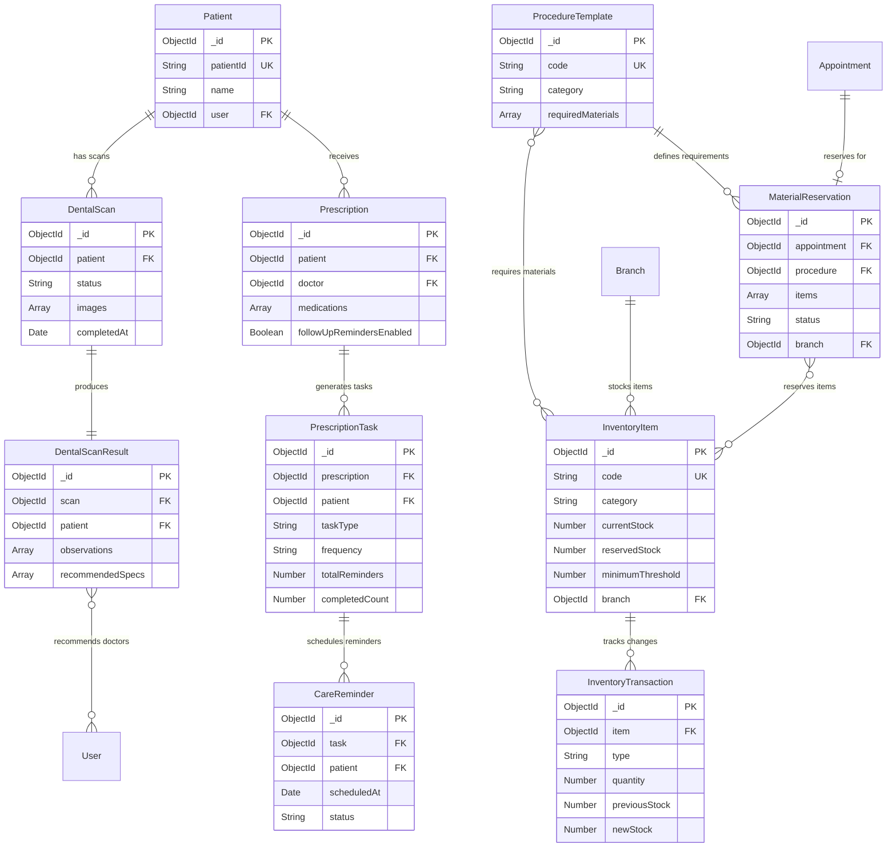

---

## **33. Job Queue Infrastructure**

### **33.1 Updated Queue Configuration**

All new queues added to `src/jobs/queues.js` following the existing lazy singleton pattern:

```
New queue entries in _createQueues():

  dentalScanAnalysisQueue: new Queue('dentalScanAnalysis', {
    connection,
    defaultJobOptions: {
      attempts: 3,
      backoff: { type: 'exponential', delay: 5000 },
      removeOnComplete: { count: 100 },
      removeOnFail: { count: 200 },
    },
  }),

  careReminderQueue: new Queue('careReminder', {
    connection,
    defaultJobOptions: {
      attempts: 3,
      backoff: { type: 'exponential', delay: 3000 },
      removeOnComplete: { count: 500 },
      removeOnFail: { count: 500 },
    },
  }),

  careReminderScanQueue: new Queue('careReminderScan', {
    connection,
    defaultJobOptions: {
      attempts: 1,
      removeOnComplete: { count: 50 },
      removeOnFail: { count: 100 },
    },
  }),
```

### **33.2 Updated Worker Bootstrap**

In `src/jobs/index.js` `startWorkers()`:

```
// Add after existing workers:
const createDentalScanWorker = require('./workers/dentalScanAnalysisWorker');
const createCareReminderWorker = require('./workers/careReminderWorker');
const createCareReminderScanWorker = require('./workers/careReminderScanWorker');

workers.push(
  createDentalScanWorker(),
  createCareReminderWorker(),
  createCareReminderScanWorker(),
);

// Schedule repeatable care reminder scan (every 30 minutes)
const { careReminderScanQueue } = require('./queues');
careReminderScanQueue.add(
  'care-reminder-scan', {},
  { repeat: { every: 30 * 60 * 1000 }, jobId: 'care-reminder-scan-repeatable' }
).catch(err => logger.error('Failed to schedule care reminder scan: %s', err.message));
```

---

## **34. Security & Authorization**

### **34.1 New Permissions**

Added to `src/config/permissions.js`:

```
// Feature 1: Dental Scan
DENTAL_SCAN_CREATE:     'dental_scan:create'
DENTAL_SCAN_READ_OWN:   'dental_scan:read_own'
DENTAL_SCAN_READ:       'dental_scan:read'

// Feature 2: Care Reminders
CARE_REMINDER_CREATE:   'care_reminder:create'
CARE_REMINDER_READ_OWN: 'care_reminder:read_own'
CARE_REMINDER_READ:     'care_reminder:read'

// Feature 3: Inventory
INVENTORY_READ:         'inventory:read'
INVENTORY_CREATE:       'inventory:create'
INVENTORY_UPDATE:       'inventory:update'
INVENTORY_DELETE:       'inventory:delete'
PROCEDURE_READ:         'procedure:read'
PROCEDURE_CREATE:       'procedure:create'
PROCEDURE_UPDATE:       'procedure:update'
RESERVATION_CREATE:     'reservation:create'
RESERVATION_READ:       'reservation:read'
RESERVATION_RELEASE:    'reservation:release'
```

### **34.2 Role-Permission Mapping**

| Permission | Patient | Doctor | Receptionist | Admin |
| :---- | :---- | :---- | :---- | :---- |
| dental_scan:create | Yes | — | — | — |
| dental_scan:read_own | Yes | — | — | — |
| dental_scan:read | — | Yes | — | Yes |
| care_reminder:create | Yes | — | — | — |
| care_reminder:read_own | Yes | — | — | — |
| care_reminder:read | — | Yes | — | Yes |
| inventory:read | — | Yes | Yes | Yes |
| inventory:create | — | — | Yes | Yes |
| inventory:update | — | — | Yes | Yes |
| inventory:delete | — | — | — | Yes |
| procedure:read | — | Yes | Yes | Yes |
| procedure:create | — | — | — | Yes |
| procedure:update | — | — | — | Yes |
| reservation:create | — | Yes | Yes | Yes |
| reservation:read | — | Yes | Yes | Yes |
| reservation:release | — | Yes | Yes | Yes |

### **34.3 Multi-Tenancy Compliance**

 • All new models stored in tenant databases (not platform DB)
 • All routes protected by `tenantResolver()` middleware
 • AI API calls include no patient PII — only images (no names, IDs, or clinic identifiers sent to external AI providers)
 • Self-hosted ML approach (Approach B) keeps all data on-premise — zero external transmission
 • Inventory data isolated per branch within tenant

---

## **35. Deployment & Migration Strategy**

### **35.1 Database Migration**

No migrations needed for new collections (MongoDB is schemaless — collections created on first insert). For the Prescription model extension:

```
// One-time migration script:
// Set default values for existing prescriptions
db.prescriptions.updateMany(
  { followUpRemindersEnabled: { $exists: false } },
  { $set: {
    followUpRemindersEnabled: false,
    tasksExtracted: false
  }}
);
```

### **35.2 Environment Variables**

New environment variables to add:

```
# Feature 1: AI Dental Scan — Provider Selection
AI_VISION_PROVIDER=openai              # 'openai' | 'google' | 'self-hosted'
AI_VISION_FALLBACK=                    # Optional fallback provider (e.g., 'openai' when self-hosted is primary)

# Approach A: OpenAI
OPENAI_API_KEY=sk-...
OPENAI_MODEL=gpt-4o

# Approach A (alt): Google Gemini
GOOGLE_AI_API_KEY=
GOOGLE_AI_MODEL=gemini-pro-vision

# Approach B: Self-Hosted ML
ML_SERVICE_URL=http://ml-service:8000
ML_SERVICE_API_KEY=

# Common
DENTAL_SCAN_MAX_IMAGES=5
DENTAL_SCAN_ANALYSIS_TIMEOUT=30000

# Feature 2: Care Reminders
CARE_REMINDER_MISSED_THRESHOLD_HOURS=4
CARE_REMINDER_SCAN_INTERVAL_MS=1800000

# Feature 3: Inventory (no new env vars required)
```

### **35.3 Deployment Sequence**

 1. Deploy database model files (no migration needed for new collections)
 2. Run Prescription migration script for existing data
 3. Deploy new modules, services, workers
 4. Deploy updated `queues.js` and `jobs/index.js`
 5. Deploy updated `routes/index.js` and `permissions.js`
 6. Deploy updated frontend (web + mobile)
 7. Verify: Redis queues created, workers running, API endpoints responding

### **35.4 Rollback Plan**

 • Feature flags can disable new features without code revert
 • New modules are additive — no existing functionality modified (except Prescription model extension)
 • New queues/workers can be stopped independently via PM2

---

## **36. AI Vision Provider Strategy & Phased Roadmap**

### **36.1 Strategy Overview**

The dental image analysis system is designed with a **provider-agnostic architecture** to allow the AI backend to evolve independently of the rest of the application. A single file (`src/services/aiAnalysis.service.js`) acts as the provider boundary. Everything above it (routes, controllers, services, queues, workers, models, mobile app, web dashboard) is completely unaware of which AI engine is being used.

### **36.2 Approach Comparison Matrix**

| Criteria | Approach A: Cloud API | Approach B: Self-Hosted ML | Approach C: Hybrid |
| :---- | :---- | :---- | :---- |
| **Time to ship** | Days | 3-6 months | Days (Phase 1) → Months (Phase 2) |
| **Upfront cost** | $0 | $5K-20K (GPU + labeling + training) | $0 initially |
| **Per-analysis cost** | ~$0.01-0.03 | ~$0.001 (fixed infra) | Decreases over time |
| **Data privacy** | Images sent to OpenAI/Google servers | Images never leave your infra | Phase 1: external, Phase 2+: internal |
| **Accuracy** | High (general purpose, not dental-specific) | Very high (dental-specific, improves with data) | Best of both worlds |
| **Dependencies** | Vendor API uptime & pricing | Your own GPU infra + ML team | Managed transition |
| **Maintenance** | Minimal — vendor handles model updates | Ongoing — retraining, monitoring, versioning | Moderate |
| **Offline capability** | None | Can run on-premise / air-gapped | Partial |
| **Customization** | Limited to prompt engineering | Full control — custom classes, thresholds | Full control (Phase 2+) |
| **Node.js changes** | `openai` npm package | `axios` (HTTP to Python service) | Both |
| **New infrastructure** | None | Python FastAPI + GPU server + Docker | Python (Phase 2+) |

### **36.3 Phased Implementation Roadmap**

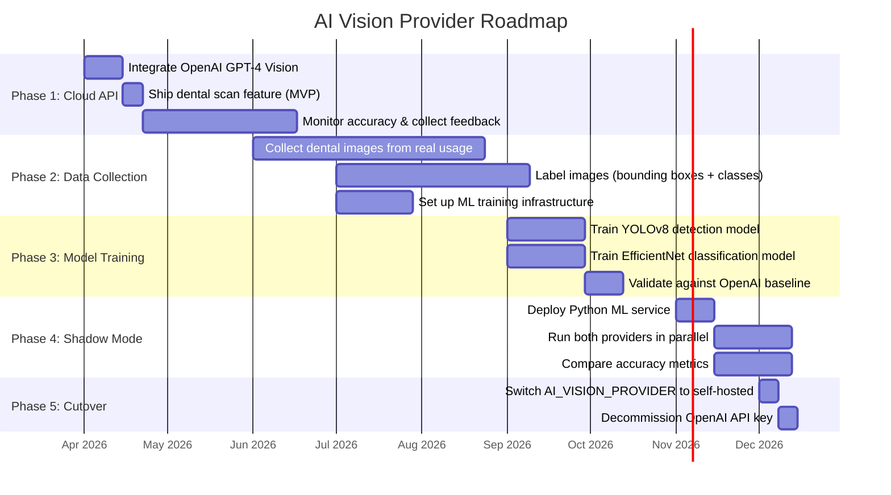

### **36.4 Phase Details**

#### **Phase 1: Cloud API (Months 1-3)**
 • Ship the dental scan feature using OpenAI GPT-4 Vision (or Gemini)
 • Set `AI_VISION_PROVIDER=openai` in production `.env`
 • Monitor: analysis accuracy, patient feedback, API costs, latency
 • Begin logging all scan images and AI responses for future training data

#### **Phase 2: Data Collection & Labeling (Months 3-6)**
 • Store all submitted dental images in a labeling pipeline (e.g., Label Studio, CVAT)
 • Hire / contract dental professionals to validate AI observations and add labels
 • Target: 5,000+ labeled images across all observation types
 • Label format: COCO bounding boxes for detection, class labels for classification
 • Store labeled dataset in versioned storage (DVC or S3 with tags)

#### **Phase 3: Model Training (Months 6-9)**
 • Train **YOLOv8** for object detection (cavity, plaque, inflammation regions)
 • Train **EfficientNet-B4** for observation classification (type + severity)
 • Validation metrics target:
   - Detection mAP@0.5: ≥ 85%
   - Classification accuracy: ≥ 88%
   - False positive rate: ≤ 5%
 • Compare model output against OpenAI responses on 500 held-out scans

#### **Phase 4: Shadow Mode (Months 9-10)**
 • Deploy Python FastAPI service alongside existing stack
 • `aiAnalysis.service.js` calls **both** providers, stores both results
 • Dashboard compares: observation match rate, confidence distribution, latency
 • No patient-facing changes — still showing OpenAI results

```
// Shadow mode implementation in aiAnalysis.service.js
async function analyzeDentalImages(images, options) {
  const primary = await _analyzeWithOpenAI(images, options);

  // Shadow: run self-hosted in background, log comparison
  _analyzeWithLocalModel(images, options)
    .then(shadow => _logComparison(primary, shadow))
    .catch(err => logger.warn('Shadow model error: %s', err.message));

  return primary; // Patient always sees cloud result during shadow mode
}
```

#### **Phase 5: Cutover (Month 10+)**
 • Once self-hosted accuracy meets/exceeds cloud API:
   - Set `AI_VISION_PROVIDER=self-hosted`
   - Monitor for 2 weeks, keep OpenAI as instant fallback
   - Remove OpenAI API key from production
 • Ongoing: retrain model quarterly with new labeled data

### **36.5 Self-Hosted ML Service — Deployment Architecture**

```
Docker Compose (production):
┌─────────────────────────────────────────────┐
│  docker-compose.yml                         │
│                                             │
│  ┌───────────────┐  ┌────────────────────┐  │
│  │ node-api      │  │ ml-service         │  │
│  │ (Express.js)  │──│ (FastAPI + PyTorch)│  │
│  │ Port 5001     │  │ Port 8000          │  │
│  └───────┬───────┘  └────────┬───────────┘  │
│          │                   │              │
│  ┌───────┴───────┐  ┌───────┴───────────┐  │
│  │ redis         │  │ ml-model-volume   │  │
│  │ (BullMQ)      │  │ (model weights)   │  │
│  └───────────────┘  └───────────────────┘  │
│                                             │
│  ┌───────────────┐                          │
│  │ mongodb       │                          │
│  └───────────────┘                          │
└─────────────────────────────────────────────┘
```

**Python service Dockerfile:**
```
FROM python:3.11-slim
RUN pip install fastapi uvicorn torch torchvision ultralytics opencv-python-headless pillow
COPY ./ml_service /app
WORKDIR /app
CMD ["uvicorn", "main:app", "--host", "0.0.0.0", "--port", "8000"]
```

**GPU requirement:**
 • Training: NVIDIA A10G / V100 (AWS `g5.xlarge` or GCP `n1-standard-4` + T4)
 • Inference: NVIDIA T4 is sufficient (~100-200ms per image)
 • CPU fallback: possible but 5-10x slower (~1-3 seconds per image)

### **36.6 Cost Comparison Over 12 Months**

Assumptions: 500 scans/month, 5 images per scan = 2,500 images/month

| Cost Item | Cloud API (12 months) | Self-Hosted (12 months) | Hybrid |
| :---- | :---- | :---- | :---- |
| API calls | 500 × $0.02 × 12 = **$120** | $0 | $60 (6 months) |
| GPU inference server | $0 | ~$200/month × 6 = **$1,200** | $1,200 (Phase 2+) |
| Labeling (5K images) | $0 | ~$2,500 (contract) | $2,500 |
| ML engineering | $0 | ~$5,000-10,000 | $5,000-10,000 |
| **Total** | **~$120** | **~$8,700-13,700** | **~$8,760-13,760** |
| **Per-scan cost (month 12)** | **$0.02** | **~$0.004** | **~$0.004** |
| **Break-even point** | — | ~5,000+ scans/month | ~5,000+ scans/month |

**Conclusion:** Cloud API is cost-effective at low volume. Self-hosted becomes cheaper at scale (5,000+ scans/month) and provides data privacy + full control.

---


---

# **Part VI: Appendices**

---

## **36. Glossary**

| Term | Definition |
| :---- | :---- |
| Tenant | A single clinic registered on the DCM SaaS platform |
| Tenant Database | Isolated MongoDB instance for a specific clinic |
| Platform Database | Shared MongoDB instance for SaaS management |
| BullMQ | Redis-backed job queue library for Node.js |
| Worker | Background process that executes queued jobs |
| Soft Delete | Setting `deletedAt` timestamp instead of physical deletion |
| Immutable Log | Append-only data store that blocks updates and deletes |
| RBAC | Role-Based Access Control |
| Feature Guard | Middleware that checks if a feature is enabled on the tenant's plan |
| Observation | A visual finding from the AI dental scan (not a diagnosis) |
| PrescriptionTask | An individual care action extracted from a prescription |
| CareReminder | A single scheduled notification instance for a care task |
| MaterialReservation | Equipment/materials set aside for a scheduled procedure |
| Procedure Template | Reusable definition of a complex procedure and its required materials |
| Compliance Rate | Percentage of care reminders completed out of total scheduled |

---

## **37. File Manifest**

### **37.1 Feature 1 — AI Dental Scan (8 new files)**

```
src/models/tenant/DentalScan.js
src/models/tenant/DentalScanResult.js
src/modules/dentalScan/dentalScan.routes.js
src/modules/dentalScan/dentalScan.controller.js
src/modules/dentalScan/dentalScan.service.js
src/modules/dentalScan/dentalScan.validator.js
src/services/aiAnalysis.service.js
src/jobs/workers/dentalScanAnalysisWorker.js
```

### **37.2 Feature 2 — Care Reminders (9 new files)**

```
src/models/tenant/PrescriptionTask.js
src/models/tenant/CareReminder.js
src/modules/careReminder/careReminder.routes.js
src/modules/careReminder/careReminder.controller.js
src/modules/careReminder/careReminder.service.js
src/modules/careReminder/careReminder.validator.js
src/utils/taskExtractor.js
src/jobs/workers/careReminderWorker.js
src/jobs/workers/careReminderScanWorker.js
```

### **37.3 Feature 3 — Inventory Management (11 new files)**

```
src/models/tenant/InventoryItem.js
src/models/tenant/InventoryTransaction.js
src/models/tenant/ProcedureTemplate.js
src/models/tenant/MaterialReservation.js
src/modules/inventory/inventory.routes.js
src/modules/inventory/inventory.controller.js
src/modules/inventory/inventory.service.js
src/modules/inventory/inventory.validator.js
src/modules/procedure/procedure.routes.js
src/modules/procedure/procedure.controller.js
src/modules/procedure/procedure.service.js
```

### **37.4 Modified Existing Files (5 files)**

```
src/jobs/queues.js                    — Add 3 new queue definitions
src/jobs/index.js                     — Register 3 new workers + 1 repeatable job
src/routes/index.js                   — Mount 3 new route prefixes
src/config/permissions.js             — Add 16 new permission keys
src/models/tenant/Prescription.js     — Add reminder fields (3 fields)
```

### **37.5 Self-Hosted ML Service — Approach B (Phase 2+ only, 5 new files)**

```
ml_service/main.py                    — FastAPI entrypoint with /analyze and /health endpoints
ml_service/models/detector.py         — YOLOv8 dental detection model wrapper
ml_service/models/classifier.py       — EfficientNet observation classifier wrapper
ml_service/preprocessing.py           — Image resize, normalize, enhance (OpenCV/Pillow)
ml_service/Dockerfile                 — Python 3.11 + PyTorch + CUDA image
ml_service/requirements.txt           — FastAPI, uvicorn, torch, ultralytics, opencv, pillow
docker-compose.ml.yml                 — Docker Compose for ML service + GPU passthrough
```

**Phase 1 Total: 28 new files + 5 modified files = 33 file changes**
**Phase 2+ Total: +7 Python/Docker files = 40 file changes**

---

## **38. Risk Assessment**

### **38.1 General Risks**

| Risk | Impact | Probability | Mitigation |
| :---- | :---- | :---- | :---- |
| AI hallucination (false observations) | Patient alarm from incorrect observations | Medium | Prominent disclaimer, confidence scores, limit to visual-only observations |
| High reminder volume overloads Redis | Delayed reminder delivery | Low | Configure BullMQ concurrency, monitor queue depth, rate-limit reminder creation |
| Concurrent stock reservations cause overselling | Procedures scheduled without materials | Medium | MongoDB atomic `$inc` operations with availability pre-check in same query |
| Patient disables reminders after partial delivery | Orphaned reminder jobs in Redis | Low | Bulk job cancellation on opt-out, scanner cleans up missed items |
| Large dental images exceed upload limits | Upload failures on slow networks | Medium | Client-side compression, chunked upload, 5MB limit per image |

### **38.2 AI Provider — Approach-Specific Risks**

#### **Approach A: Cloud API (OpenAI / Gemini / Azure)**

| Risk | Impact | Probability | Mitigation |
| :---- | :---- | :---- | :---- |
| API downtime / rate limiting | Scan analysis unavailable | Low | BullMQ retry with exponential backoff (3 attempts), patient notified to retry later |
| API pricing change / cost escalation | Unexpected infrastructure costs | Medium | Per-tenant scan limits, usage tracking, cost alerts, budget caps in billing dashboard |
| Data privacy concerns (images sent to third-party) | Regulatory non-compliance, patient distrust | Medium | No PII sent with images, patient consent screen, privacy policy disclosure |
| Vendor deprecates model | Must migrate to new model version | Low | Provider-agnostic interface allows quick swap; pin model version in env var |
| Response format changes | Parsing failures in `aiAnalysis.service.js` | Low | Schema validation layer catches format issues; version-pin API calls |

#### **Approach B: Self-Hosted ML Model**

| Risk | Impact | Probability | Mitigation |
| :---- | :---- | :---- | :---- |
| Insufficient training data | Low model accuracy, unusable results | High (initially) | Use cloud API for Phase 1 while collecting data; augmentation techniques |
| GPU infrastructure failure | Scan analysis unavailable | Medium | Fallback to cloud API provider (`AI_VISION_FALLBACK=openai` env var) |
| Model drift over time | Accuracy degradation as dental patterns evolve | Medium | Quarterly retraining schedule, accuracy monitoring dashboard |
| ML expertise dependency | Cannot maintain/improve model without specialist | Medium | Document training pipeline, use standard frameworks (YOLOv8, EfficientNet) |
| Python service memory leak / crash | Worker crashes under load | Low | Docker health checks, auto-restart via PM2/Docker, resource limits |
| High upfront investment with uncertain ROI | Sunk cost if scan feature has low adoption | Medium | Hybrid approach — only invest in Phase 2 after validating demand with Phase 1 |

#### **Approach C: Hybrid (Recommended)**

| Risk | Impact | Probability | Mitigation |
| :---- | :---- | :---- | :---- |
| Shadow mode adds latency | Slightly slower analysis during comparison phase | Low | Shadow call is fire-and-forget (async), does not block patient response |
| Cutover timing misjudged | Self-hosted model not ready, forced to stay on cloud | Low | Keep cloud API active as fallback; no hard deadline for cutover |
| Dual infrastructure cost during transition | Paying for both cloud API + GPU server | Low | Shadow phase is temporary (4-8 weeks); cloud API cost is minimal |

---

**End of Document**

---

*DCM Feature SRS v2.0 — March 9, 2026*
*Prepared for the DCM Development Team*
